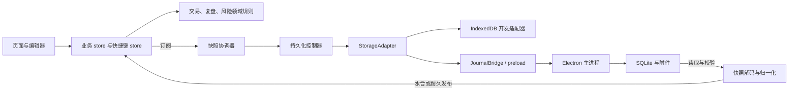

# Trader Atlas 架构地图与治理进度

基线为 `ac1d30c7`。桌面客户端支持 Windows 与 macOS。治理在隔离 worktree 中进行，每批提交包含调用方迁移、对应测试和本页的决策记录。

## 业务与代码所有权

| 工作对象 | 入口、状态所有者和修改位置 | 契约与验证 |
| --- | --- | --- |
| 实盘、模拟、回测、案例 | `src/data/trades.ts` 定义记录。交易真值由 `tradeTruth` 解释，生命周期见 `tradeStatus`、`tradeTransition`；回测按 `backtestProjects` 的项目边界计算 | 财务计算、风险门与回测项目各有行为测试。历史交易日取决于资料库换日设置 |
| 阶段、风险、复盘 | `liveStages`、`riskBudget`、`tradeOpenRiskGate` 形成决策，`riskGatedTradeOpenCommit` 提交并发布；`src/data/weeklyReviews.ts`、`src/lib/reviewSession.ts` 承载周期与随机复盘 | 阶段归属、冻结证据、风险确认和周复盘测试 |
| 页面和输入 | `App.tsx` 组合路由与全局交互，`views` 和 `components` 消费 store、领域规则；编辑器位于 `src/editor`，快捷键作用域与绑定规则位于 `src/shortcuts` | 设计来源依次为 tokens、global CSS、公共组件和局部布局；组件交互用 renderer 测试、Electron 实机验证 |
| 运行状态 | Zustand `useStore` 管理业务集合及部分临时 UI；`shortcutStore` 管理快捷键，`saveStatus` 只描述写入状态。表单本地草稿、路由筛选、持久化视图偏好具有不同生存期 | `persistedKeys` 约束快照字段，`pickPersisted` 投影，`snapshotToRuntimeState` 水合 |
| 保存与并发 | `bootstrap` 安装订阅；`persistedSnapshotCoordinator` 过滤无修改发布；`persistenceController` 排队写入；`cutover` 协调切库交互。正文草稿由 `noteDrafts` 按记录持有 | CAS 修订、批次提交、草稿刷新、恢复与失败补偿分别有测试。store 引用版本和数据库 revision 属于不同时间点 |
| 存储与缓存 | `StorageAdapter` 是接口，`provider` 按环境选实现。桌面通过 preload 调用 SQLite 与附件目录，IndexedDB 用于开发测试。图片临时 URL 的所有者通过 `assetObjectUrls` 取得和释放租约 | `snapshotCodec` 解码历史资料，`snapshotValidation` 校验数据；旧模块兼容见同目录退役记录 |
| 平台接口与信任边界 | `JournalBridge` 定义跨进程 API，`electron/preload.ts` 只暴露命名能力；主窗口启用 sandbox 和 context isolation。主进程处理文件选择、库路径、备份、剪贴板与更新 | 资料库激活、受管路径、退出确认和恢复授权有独立测试。真实库路径优先级见 `libraryLocation` |
| 配置、错误和诊断 | 默认资料配置在 `src/config`；构建开关由 Vite 与打包命令传入；平台启动配置由主进程读取。`OperationalError` 承载业务错误，持久化错误保留具体阶段，主进程与 Web 各有操作日志输出 | 错误展示、诊断脱敏、日志配对、写入重试由各边界的测试负责 |
| 其他交付物 | `tools/atlas-data-editor` 是离线资料库编辑器；`execution-trainer` 有独立进程和模型；`atlas-website`、`atlas-docs-site` 各自构建或验证；`prototypes` 存放独立样稿 | 分别使用离线编辑器测试、训练器 test、官网构建与教学站 verify；产品站点、原型不依赖桌面会话 |
| 验证与发布 | `scripts/test-discovery.mjs` 发现回归入口；`quality-scenarios.json` 关联发布合同；CI 执行 `qa:ci`。候选认证与正式 tag 工作流拥有不同职责 | 安装包清单在 `scripts/release-artifacts.mjs`，最终门禁要求双平台资产 |

## 运行依赖与状态流向

图中箭头覆盖调用和数据流。对基线的 `src`、`electron` 另作静态模块扫描，去除测试、fixture、benchmark、声明和编译时类型后，共得到 383 个 TS/TSX 模块，1,876 条不同的本地同步静态依赖边，未发现强连通环。此统计不含动态加载、IPC 或回调。

## 独立交付物与外部契约

| 交付物 | 状态、外部入口与边界 | 本轮核查 |
| --- | --- | --- |
| 离线资料库编辑器 | 用户通过文件选择器打开来源目录，浏览器内存持有编辑及撤销历史，导出另一个目录。SQLite 元数据中的快照经 Atlas 的 codec 升级。编辑器还需保留未知扩展字段 | 以纯合成 SQLite 库通过编辑、失败导出、重新打开、附件字节及来源库未变校验。单独的 TypeScript 项目现接入 CI |
| Execution Trainer | 主进程限定 IPC 来自本窗口主框架。其 Store 只读写训练器 userData 下的 records，基于训练事件重建按时区划分的训练日及缓存。preload 仅公开训练与窗口操作 | 模型、缓存 10 项回归通过。字体与 Token 使用注明源提交的设计快照。训练记录与 Atlas 交易快照独立演进 |
| 官网与指南 | 官网构建脚本组合静态产品页与指南。指南以 lessons 为章节数据源，搜索索引由内容生成，用户学习进度保存在站点 localStorage。产品截图来自独立演示库 | 章节检测覆盖 11 章、44 步及前置章节引用。网站构建和运行检查在 atlas-website 的 README 有独立入口 |

## 已落地的架构决策

| 概念 | 权威实现 | 保留的边界 |
| --- | --- | --- |
| 交易写入与复盘 | `tradeUpsert` 处理单条及批量写入，`tradeResult` 处理结果与复盘重开，`tradeWorkflow` 判定日志待完善、详情待复盘与同序列下一条 | 工作台范围由日志筛选决定，正文是否写好和用户是否已确认复盘可以不同 |
| 并发与恢复 | `persistedRevision` 比较状态引用，`committedPublish` 管理批次提交与补偿，`persistenceController` 按调用方一次性归还保存暂停 | 同库恢复由 `libraryRestore` 负责，切库候选激活由 `librarySwitch` 负责，二者共用切换状态不确定时的禁写与恢复处理 |
| 资料库与附件 | `libraryDatabase` 负责 SQLite 建表、版本选择和附件索引可移植性，`assetPurge` 解释构建与运行开关，`libraryFiles` 负责离线副本交付 | 目录权限属于平台。离线工具保存当前编辑副本，数据库摘要只要求于带该字段的恢复记录 |
| 快捷键覆盖 | `bindingRules` 决定哪些绑定偏离出厂值，快照调度与覆盖导出共用 `storedBindingsEqual` | 单次按键、按序列触发和显式禁用分别保存。系统热键注册仍归桌面管理，绑定中附带的扩展字段保留 |
| 快照写入与导出 | `snapshotProjection` 按活跃字段注册表取值，自动保存和可移植快照共用字段选择 | 自动保存保持业务引用并检查当前阶段。文件导出补齐历史缺省值、复制阶段和排除界面状态。工作流负责附件读取与提交 |
| 运行时资料库快照 | `snapshotToRuntimeState` 一次投影全部业务字段，类型检查跟踪活跃快照字段 | 快捷键由独立 store 处理系统热键冲突。启动读取缺少用户资料的旧快照时保留当前资料，整库恢复时回退到默认身份 |
| 编辑草稿身份 | `noteDrafts` 用正文域和完整记录 ID 定位草稿、在途保存、迟到附件和恢复导出 | 内存键不进入持久化格式；历史交易 ID 可包含冒号和与随记／周复盘相同的前缀 |
| 活跃正文与附件引用 | `snapshotRichText` 按交易、周复盘、随记逐条枚举，包含案例来源正文。盘点、归档、JSON 导入与 IndexedDB 共用候选识别次序 | 调用方决定合法性、去重、诊断和调度。离线编辑器还需保护未知扩展字段中的引用 |
| 储存大小展示 | `src/lib/format.ts` 的 `fmtBytes` 为数据健康、备份、清理与归档预览提供显示值 | 用二进制换算，保留原有 B／KB／MB 单位及小数位 |
| 编码与文件校验 | `base64` 与 `crc32` 分别管理附件编码和 ZIP 校验，`sha256` 管理内存字节摘要，`fileChecksum` 与 `atomicFile` 管理桌面文件校验和刷新 | 桌面分块读取和浏览器的内存字节输入具有不同的资源成本。基准使用独立算法核对生产结果 |
| 风控与操作诊断 | `riskFingerprint` 保留既有证据身份，`operationLog` 管理配对与首个终态 | Web 诊断脱敏和桌面日志输出分别由各自运行环境负责 |
| 架构与验收 | `governance-imports` 从桌面、离线编辑器、训练器以及两站实际发布的模块生成本地同步与延迟依赖图；`test-discovery` 与运行报告负责证据归属 | 统计门禁需要真实运行的选择器、聚合器及页面证据。离线工具使用自身构建和 Chromium 文件读写回归 |

## 优化任务池

| 状态 | 观察与下一步 | 验证边界 |
| --- | --- | --- |
| 已完成 | Web 归档的版本、附件声明及正文引用由 `webJournalArchiveContract` 管理。两端用同一组字节核对省略版本、显式空版本和草稿附件恢复 | Web 保留有原字节的恢复白名单。桌面保留文件树与可移植性校验。两端维持各自报错类别、文本和校验顺序 |
| 已完成 | 由 `JournalImportPreviews` 持有归档文件选择至预览消费之间的请求、有效期与暂存目录，IPC 只安排原生选择器和提交事务 | 正在读取或替换数据库时由持有操作完成清理；取消、退出页面、窗口释放及过期都有覆盖 |
| 已完成 | 离线编辑器、训练器与桌面代码在同一张运行依赖图中。离线编辑器可复用快照、校验与领域规则，独立工具不能获取 Atlas 会话或主进程 | 经仓库其他目录转发、延迟导入或 CommonJS 引用仍能追踪。官网与指南按构建清单中的 URL 解析，静态页面与 CSS 引用由成品检查覆盖 |
| 已完成 | `backupRestore` 负责单次备份恢复的来源验证、安全副本、关闭、磁盘替换与重新接管写入。归档和备份恢复使用同一份安全副本验证规则 | 忙请求不接管其他请求的库，恢复失败时在原独占期内重开。空库写入不确定仍广播恢复要求 |
| 已完成 | 打开其他库、新建、整库恢复、整理和 Web 冲突重载统一通过 `replaceLibraryInStore` 替换会话；同库普通刷新使用 `applySnapshotToStore` | 新业务记录与选择、编辑、开平仓请求、撤销栈在同次业务 store 发布中交接。资料库预设和暂存交互分别由其所属边界处理 |
| 已完成 | 状态查询、归档预检、切库候选检查在共享操作内读取活动库；归档恢复与阶段重置先取得独占权，再验证同一实例的写入会话 | 状态查询会通过开库处理未完成事务。隔离 Electron 覆盖活动恢复标记、并发请求和恢复后耐久内容 |
| 已完成 | 配置中的身份传入 SQLite 开库与恢复；归档、备份和 schema 中断按已验证恢复副本确认身份后才写盘。启动和备份恢复共用配置开库流程 | 覆盖配置错误指向其他 v8 库、迁移中断的三个阶段、归档与备份的半成品清单、正确身份下的继续恢复。旧配置仍可省略身份 |
| 已完成 | 资料库的配置、环境变量与默认位置由 `libraryLocation` 解释；SQLite、备份及路径操作只能接收调用方给出的实例或目录 | 构造器要求显式路径。依赖门禁止底层经同步或延迟依赖重新调用选库逻辑。备份列表、验证及位置状态由 JournalBridge 提供类型 |
| 已完成 | Electron 附件清理、快照保存和批次导入从同一个磁盘候选读取、比较和推进版本，物理清理与重启共用 trash 收尾 | 预览后内容改回原样、磁盘快照重新引用原图、替换后无法读取、重新打开及接续写入均单独验证 |
| 已完成 | 切库与恢复在同一持锁回执中携带快照和版本，阶段操作仅在本窗口基于相同起点且成功时推进版本 | 原生恢复验收中关闭单独的版本查询，验证阶段拒绝、两种恢复、新建、切回及每次接续保存 |
| 已完成 | 自动备份由 `LibraryAutoBackup` 持有当前库、15 分钟定时器和操作门。切库先校验候选目录，位置配置成功后才移交定时器和轮换备份 | 同一库重复打开维持到期时间。失败切库两边保留全部历史，成功后只轮换新库；占用时跳过，备份失败通知工作台 |
| 已完成 | 位置配置替换后发生异常时，由配置写入方再次执行平台目录同步并比对已发布字节；无法确认时主进程释放旧实例，界面按激活回执重载 | 确认时当前库与重启所选库一致。无法确认时旧凭据禁止保存，重开按配置与身份取得新会话。替换前失败仍保留原实例 |
| 已完成 | 清理预览及可选恢复归档凭据由每个库实例的 `AssetPurgePreviews` 持有。桌面与 IndexedDB 共用候选统计、版本与字段匹配、凭据过期和一次性消费规则 | 取消或库实例重开后不能导出；异步导出结束时校验当前版本及预览。桌面在真实归档验证后签发，提交时复查文件类型及摘要；Web 保留导出时的附件字节和提交事务 |
| 已完成 | 桌面写入会话在主框架提交新文档、进程消失、窗口关闭、重新开库或切库时撤销；同时清理该会话的附件清理预览。归档导入和写入会话使用同一组文档结束事件 | 同文档导航保留会话。文件选择器等待期间允许撤销内存中的预览；选定路径后再次验证，已经开始的文件写入按原流程完成 |
| 已完成 | 设置页的附件清理入口和弹窗由 AssetPurgeControl 管理；每次打开的 AssetPurgeSession 负责初次扫描、导出前重扫与关闭后回收，数据设置只提供清理入口的可见条件和健康刷新 | 离页释放已展示和正在导出的两份预览；迟到的扫描返回给原适配器，迟到的 Web 导出不会下载。取消或导出失败仍可使用原预览直接确认清理 |
| 已完成 | 客户端五个 Blob 下载入口通过 downloadBlob 提交临时链接并负责 URL 释放：JSON、完整 Web 归档、冲突抢救、清理恢复归档、回测项目分析包 | 下载交接失败时立即回收。分析包成功交接后沿用 60 秒延迟释放；文件内容和名称仍由各导出方决定 |
| 已完成 | 完成按钮与记录菜单使用 completeTradeReview；整库替换在发布业务数据时更新内存会话并撤销旧正文草稿。同库普通刷新保留会话 | 复盘提交在草稿保存后检查所属库、最新记录状态和正文。旧图片处理不能启动下一次保存。相同 ID 的新记录重新加载编辑器 |
| 已完成 | 粘贴与拖入图片共用 insertEditorImage。异步落盘、重试和离页补写均绑定发起资料库 | 导航离开后仍可向原记录补写。整库替换后，无论源编辑器存活还是已销毁，目标库都没有新增图片引用或读取附件 |
| 已完成 | 记录详情通过 useTradeNote 读取、重试、修复和编辑正文。当前记录的加载结果持有正文与只读状态，附件租约随加载结束释放 | 展示性变化只更新显示；用户输入立即进入可恢复草稿，空闲或离开时刷新。重试期间保持同一只读编辑器，主动移除缺图时使用最新正文 |
| 已完成 | 交易详情、随记和周复盘共用 withLibrarySession；整库替换后重新建立当前文档的输入、撤销和确认状态。随记转换锁同时区分库和记录 | 用旧库在途图片阻塞完成或转换，然后替换为同 ID 文档。新库仍可独立操作；旧库命令没有新增案例或冻结指标 |
| 已完成 | 随记与周复盘均通过 useDraftNoteEditor 读取草稿、解析附件、管理只读与重试、空闲保存并在离页刷新 | 读取或重试均保留内存草稿；交易详情另有先提交再读的约定。随记撤销只恢复当前库历史，周复盘首次编辑仍创建归属记录 |
| 已完成 | getStorage 只由 storage/provider 导出。应用启动、环境识别、富文本引用枚举和存储操作分别指向各自实现；删除私有应用内部不含逻辑的 storage/index | 34 个应用或测试模块完成迁移。依赖图门禁从 12 个存储使用方追踪同步与延迟依赖，阻止经中间模块再加载 bootstrap |
| 已完成 | submitWeeklyReview 按发起库、复盘 ID、周次和实盘阶段确认原记录；冻结前重新校验保存结果、最新字段和完成状态 | 程序入口和页面使用同一提交操作。双击只冻结一次；离开页面后原周可以完成，后到的提示和焦点不会落到另一周 |
| 已完成 | evaluateWeeklyReviewCompletion 为周复盘提交、进度计数和字段提示提供同一份评估。界面只将缺失字段映射到相应控件 | 草稿失败的提示优先，评分和行动承诺顺序不变。覆盖全部 32 种字段组合及两种保存结果 |
| 已完成 | 选择器、日历、交易范围、交易筛选、快捷视图和上下文菜单关闭后，共用 restoreFocusAfterClose 将焦点归还原入口。已有焦点、被移除的入口和上层模态框遵循现有归还规则 | Chromium 覆盖选值、Escape 和日期确认后立即聚焦下一控件。macOS 输入五个必填项后以 Enter 完成复盘，重开后读回相同评分、正文、完成时间及三份快照 |
| 已完成 | 应用路由边界记录 push、replace、go 和原生历史遍历。周复盘与随记通过 useNavigationIntent 判断异步保存结束时是否仍可接管导航；业务页面不再改写共享路由器 | 真实 HashRouter 回归核对周切换和外部后退的每一次历史写入。目标页面尚在加载时，转换可保存案例并提供回执；主动返回原随记仍能进入生成的详情 |
| 已完成 | toastStore 拥有通知队列、可见快照、计时和挂起状态。渲染层只订阅可见快照；删除单条镜像、可任意替换队列的入口以及旧动作字段 | 逐项核查 200 处应用通知发送，迁移仍用旧字段的五个入口。可见项按原规则去重和计时；更新隐藏项不会唤醒界面，显示时读取最新正文和操作 |
| 已完成 | 交易详情的案例提炼、复盘字段提示与焦点、决策图打开均检查应用导航意图。提炼命令只在发起详情仍拥有操作时写入；复盘完成沿用原交易提交规则 | Chromium 延迟目的页渲染期间，旧提炼不创建案例、不抢回导航。macOS 快速操作后仍在周复盘，原交易正文已落盘，隔离数据库中的案例 ID 集合保持一致 |
| 已完成 | 启动、同库刷新与整库替换通过相同投影发布用户资料、风控确认和交易记录 | 同步业务订阅读到恢复标签的每一次通知都携带恢复后的身份。覆盖旧格式缺省与中性显示名 |
| 已完成 | 将快捷键覆盖投影从 Zustand 移回纯规则，设置、提示、导出和回归直接依赖规则所有者 | 默认组合键调整属性顺序、关闭修饰键均不产生覆盖。序列重排、禁用、真实改键和历史扩展仍能写回 |
| 已完成 | 自动保存、交易命令、导入补偿、导出与基准直接使用纯快照投影。导出类型从存储合同派生 | 回归检查 26 个字段、业务引用、旧格式风险数组、扩展元数据和附件。架构检查遍历投影的同步与动态依赖 |
| 已完成 | 协调器先比较业务字段引用，再按需捕获完整快照。两条订阅共用最后一次成功调度的完整基线 | 实际 bootstrap 的 Chromium 测试覆盖只选中记录和真实资料编辑。调度失败、嵌套耐久刷新和快捷键回退仍可重试 |
| 已完成 | 预置头像、上传和恢复默认由同一头像状态控制；整库交接会撤销待写图片。资料表单草稿与保存反馈随资料库会话更新 | 上传失败与迟到成功按发起请求判断。名称保存回滚只作用于发起库；覆盖新库恰好同名的情形 |
| 已完成 | 桌面首次开库与设置内激活共用 LibrarySwitchTargets。准备已有库时保存清单身份，新建时只检查路径；实际打开时重新读取快照与版本 | 覆盖选中后目录换库、同库内容更新、当前库的路径别名与复制副本，以及空目录在准备后新增文件 |
| 已完成 | LibrarySwitchRequests 持有检查中的窗口文档、候选的单次消费和有效期；切库、归档与写入会话共用文档结束事件 | 同文档路由保留候选，刷新、进程退出或关闭释放候选。迟到的检查不能取代新文档的请求。激活时同时核对原资料库实例和写入会话 |
| 已完成 | LibraryOperationGate 共用一条独占入口；正在写入时最多保留一个独占等待者，退出取消立即释放 | 两个并行写入、退出取消、再次申请和备份非阻塞入口分别覆盖；延迟第一个写入时检查旧请求可回收 |
| 已完成 | journalBridge.ts 同时拥有桌面桥接接口和 Window 成员。预加载实现直接按窗口公开类型检查；设置、侧栏和备份展示直接引用契约 | 治理门解析桌面源文件与环境声明，分别检查两种声明具有唯一归属。覆盖另外目录中的同名定义、类型导入和注释 |
| 已完成 | 欢迎页的新建与打开通过同一条激活流程消费 JournalBridge 回执。位置写入结果未确认时，进入现有的主进程恢复流程 | 在欢迎页分别提交两种操作，验证具体拒绝原因、保留所选目录、同帧重复点击和恢复失败后的重试入口 |
| 已完成 | 恢复要求中止原文档的存储启动。开库、快照发布、快捷键水合与开启自动保存共享同一取消信号；旧资料迁移在写入边界检查信号 | Chromium 延迟桌面快照读取后触发恢复；迁移回归在第一张图片与旧快照提交期间分别触发恢复，核对后续写入及原始来源 |
| 已完成 | useWorkspaceStartup 负责初始化、欢迎页完成、普通重试及需主进程重开的互斥界面状态；三个成功入口共用阶段检查、过期清理及字体等待 | 用延迟字体和真实过期交易核对三个入口的操作顺序；普通重试重新检查配置，迟到的启动失败保留当前恢复原因 |
| 已完成 | 单次旧库迁移顺序保存正文附件；桌面与 IndexedDB 直接使用 externalizeSnapshotNotes，移除仅供测试转发的入口 | 首图失败时，其他记录没有在途或迟到写入；从未改写的原快照重试，按交易、来源案例、周复盘及随记核对附件字节和引用 |
| 已完成 | 欢迎页只负责选目录与显示结果。启动流程按当前文档是否已载入库决定首次开库或复用设置页的两阶段切换 | 旧库已载入后分别打开已有库、新建空库，检查目标资料、写入凭据和两库修改归属；恢复已接管文档时忽略迟到的选库结果 |
| 已完成 | 欢迎页目录按钮采用公共 OverflowTooltip，长路径沿用工具栏标题的单行截断与键盘预览 | 以深层目录测量按钮裁切，核对鼠标与焦点可查看完整路径，再通过真实按钮打开所选库 |
| 已完成 | 持久化模块持有文档恢复信号。启动水合与两个活动库切换入口在同一信号下停止，切换期间归还交互锁、暂停和候选令牌 | 延迟旧库已落盘保存的回执，再发恢复通知。回执前恢复按钮应可操作，候选取消一次；回执后不得改变配置或发布目标库 |
| 已完成 | Git Hook、全仓治理和桌面设计检查共用仓库文本解码规则；Hook 仍只检查 Git 索引，全仓仍识别无扩展名文本和二进制 | 在临时克隆把 UTF-16LE 无 BOM 的 PowerShell 脚本暂存，两条真实命令应拒绝；中文 UTF-8、部分暂存、二进制、重命名与删除有回归 |
| 已完成 | 成功激活回执直接给出本次已写入配置的库路径与快照。活动库切换成功后无需再次访问资料库判断结果 | 给激活后的路径查询注入忙错误，用与实际规范路径不同的选择字符串调用，核对回执路径、目标数据与可继续写入；失败前后仍独立核对原库 |
| 已完成 | 回归构建位于 test-results，安装依赖目录及其目录链接使用同一 Git 忽略规则 | 在真实临时仓库维持一次回归运行，让第二个进程取指纹并运行相同测试；两个进程独立清理，期间源码身份保持不变 |
| 已完成 | Node 和回归运行器在发现测试前固定源码身份，执行报告与桌面构建证据共用本地源码核对规则 | 两个临时 Git 仓库分别在执行旧模块时改写依赖，运行器应拒绝登记通过。报告原子替换，每个测试文件的所有用例共用同次文件摘要 |
| 已完成 | 两条平台回归沿用各自命令和报告格式，由 platform-regression 统一运行与核对。发布复验使用相同的入口清单和场景 ID | 子进程须返回实际执行的文件和用例。覆盖近似名称、控制台打印同名通过消息、提前正常退出以及运行中改写源码 |
| 已完成 | 工作树文件由 git-worktree 按实际 Git 路径枚举。源码指纹、治理、品牌与官网构建检查复用同一清单，暂存检查只与它们共用路径解码 | 临时仓库覆盖中文、反斜线、换行、文件名前导 U+FEFF、文件与目录互换、替换父目录的链接、链接改目标、执行位以及未跟踪资料的检查边界 |
| 已完成 | 本地发布验收使用自己启动的 Vite 服务，按实际成功顺序记录子命令。完整与冒烟共用源码复核，性能步骤仍使用本次生产构建 | 两份临时 Git 工作树并行启动真实服务并读取各自首页，检查关闭后端口释放。命令替身另行验证运行中改源码会拒发报告，独立页面探针地址不会混入完整验收 |
| 已完成 | 无窗口 Electron 冒烟与强杀回归共用子进程启动和收尾。每个进程使用独立用户目录，强杀重开时只共享本轮明确指定的资料库 | 子进程替身验证隔离路径、空结果、缺少数据库和超时退出。强杀的库路径随本次运行传递，进程退出后再清理用户目录和测试库 |
| 已完成 | 浏览器测试的逐帧条件等待归入 test/browserTiming。采用该轮询方式的入口各自保留原有的 2、4、5 或 8 秒时限 | 启动中断先等待应用的 uiSettled，再核对具体恢复原因、侧栏、快照与保存次数。计帧、计时器和布局测量继续按各自契约等待 |
| 已完成 | 质量报告的清空与合并使用同一跨进程文件锁，耗时的测试与文件摘要计算继续并行。保持已有报告路径与格式 | 两个独立进程延迟读取同一份旧报告，写入后应保留双方的文件和用例。实际终止持锁进程后验证陈旧锁可回收，新一轮能清空并重新发布 |
| 已完成 | 强杀恢复的生产者与发布复验从当前检出的 SCHEMA_VERSION 取得预期版本，纯验证函数也可显式复验历史版本 | 报告头和三个实际恢复边界分别按受验证版本检查。保留历史 v12 样本，并验证版本不匹配或只改报告头会被拒绝 |
| 已完成 | 工作台与侧栏的键盘验收等待指定控件获得焦点，沿用同一个 Playwright 定位条件 | 平仓等待盈亏金额，正反 Tab 检查边界按钮，Escape 后核对原状态入口；超时仍计为失败 |
| 已完成 | 侧栏排序、删除保存视图与恢复默认共用同库新文档复验。原隔离资料名必须在重新载入后出现 | 删除后同时检查原名称与失效引用，恢复时独立检查落盘项目 ID 和重新显示的准确名称顺序 |
| 已完成 | 开发态验收与浏览器基准共用 qa-vite-server。每次运行拥有自己的监听地址和预构建缓存；受限入口按工作树实际路径范围供给源码 | 同目录并行运行工作台和侧栏，独立加载统计页。真实 Vite 回归验证两个不同的依赖包、关闭其中一个后另一个的原始 URL、配置失败时的清理 |
| 已完成 | 兼容旧浏览器库时，目标快照是否可写由复制快照、附件与元数据的同一 IndexedDB 事务决定。读取来源后还须确认该批数据含主快照 | 并行迁移仅一方提交，另一方跳过。预检后新提交的记录、原图和版本全部保留；在读出前消失的源快照不能留下单独的附件或元数据 |
| 已完成 | IndexedDB 适配器与旧库迁移的写入目标共用 indexedDbSchema 定义对象存储、主键及补建流程。读取兼容来源仍要求数据库已存在 | 两个入口均以被其他连接占用的 v1 部分库复核；报错后原版本及存储目录不变，主动重试保留原记录并能释放所有连接 |
| 已完成 | IndexedDB 首次初始化在写事务中决定库身份。读取或创建的清单统一通过版本校验，再交给适配器 | 在预检与提交之间写入 v15 或未来 v16 清单和修订 42；当前版本沿用原身份，未来版本拒绝打开，磁盘字段保持一致 |
| 已完成 | IndexedDB 读取原快照与主动迁移分开。保存、显式版本提交、导入及恢复共用写入队列和同一份已知修订及附件引用 | v1 旧库首次写入曾在队列中等待自身迁移。真实 Chromium 验证四个入口均在一次事务内推进到修订 1；新增缺失引用拒绝且磁盘不变，历史缺图仍可编辑，已知版本的写入和快速冲突均无整份快照读取 |
| 已完成 | 旧浏览器库的单快照读取、三表游标复制、目标写入均以对应事务的完成或中止为唯一回执 | 在来源预检和全量扫描分别中断原生事务。调用方各收到一次 AbortError，页面无额外未处理错误；重试得到原始附件和修订 3 |
| 已完成 | IndexedDB 的打开、排队写入、迁移、清理预览及其回执都受当前库生命周期约束。关闭时撤销写入资格并释放队列与缓存，同一有效库重新打开仍保留暂存附件 | 原生 Chromium 中旧库关闭并重建为相同库名和修订 1 后，旧操作曾把新库覆盖至修订 3。现在两笔旧操作均返回 AbortError，新库仍为修订 1 且可独立继续编辑。扫描完再取消也不能复制旧库附件 |
| 已完成 | 旧资料初始化通过 commitImport 一次提交快照、已有附件与刚从正文提取的图片。准备阶段只处理本次调用的内存字节，桌面区分新图片与已有附件的命名合同 | macOS 隔离库最后一张图片解析失败时曾留下两个已提交附件，IndexedDB 同一故障曾留下暂存附件。回归检查失败、重试、旧引用及 GIF 原图命名和字节 |
| 已完成 | 首次初始化在 IndexedDB 写事务和 SQLite 磁盘候选中检查主快照键。所有导入入口使用同一份提交选项，普通导入仍按原修订规则执行 | 两种引擎均复现了目标先被初始化、调用方取得最新修订后仍覆盖赢家。现在拒绝迟到的初始化，保留赢家内容、修订、附件目录和旧来源 |
| 已完成 | 清理旧 localStorage 时复核本次实际解码的原文；从空来源建立默认库时没有需要清理的键 | 在真实 Chromium 的目标提交回执前替换旧原文，或在原键不存在时新写一份。两种情况均保留新原文及目标修订 1；未变化的旧原文仍按既有契约清理 |
| 已完成 | SQLite 保存与批量导入共用快照写入，统一推进修订，并在同一候选中记录新正文和其真实格式版本 | 实际 v7 磁盘库导入手工阶段后，重开曾把阶段改为 legacy-live-stage-1。显式 v7 和缺版本的旧库现均保留原阶段 ID、历史清单及修订 1，数据库版本记录为当前值 |
| 已完成 | 旧资料初始化目的端只依赖读取快照和批量提交，浏览器来源只额外提供开库及读取附件。回归夹具遵循实际接口 | 首装默认配置、无效来源、磁盘拒绝提交与图片顺序均走真实的调用合同；移除强制类型转换及无关的假存储方法 |
| 已完成 | 两种存储共用快照修订键、整数范围与递增上限。SQLite 解码十进制文本，IndexedDB 解码数值，缺少修订键的旧库仍从 0 开始 | 真实引擎在提交事务内拒绝修订溢出或元数据损坏；重开后快照、附件和最后合法修订仍可读取。桌面批次覆盖了空白、二进制、非整数和超范围输入 |
| 已完成 | 归档和备份候选、原生开库及 schema 中断恢复在采纳文件对前，按与实际保存相同的规则读取修订 | 实测内容校验和正确但修订损坏的备份曾返回已提交失败；同类归档曾替换原库。现均在替换前拒绝。v8 源损坏时保留原字节，已替换的候选损坏时从原文件对继续恢复 |
| 已完成 | 归档预览、附件清理安全副本验证和直接导入共用私有候选准备；只有直接导入或确认预览才进入同一个文件替换与回滚流程。目标身份在准备候选时确定 | 生产预览和安全归档验证曾各生成一次临时库替换标记；现在两次检查合计零次，确认恢复后仅真实目标生成一次。预览后源文件变更、提交拷贝中断、原图及目标身份均有回归 |
| 已完成 | 持久化与存储热点两套基准在 test-results 下独占 SSR 构建目录，按调用生命周期清理并保留各自的报告路径 | 基准运行期间，仓库根目录生成的 runner 和入口曾使同提交的治理门报告源码身份不符。现在同一次构建抛错不会清理其他构建，也不会将夹具计入源码 |
| 已完成 | 活动库的备份验证、恢复、安全副本、退出与阶段切换均要求候选按目标库身份打开。路径级离线验证保留单独检查恢复点的能力 | 将另一个隔离库的完整有效备份复制到本库后，旧恢复入口成功采用了对方的身份；现于关闭前拒绝，原 DB、清单、修订和同一会话的后续写入均通过验证 |
| 已完成 | 备份恢复在一次私有暂存中复制数据库、清单与附件，校验已复制的字节，并持有这份候选直到安装完成。路径级恢复与正式恢复共用物理安装和中断回滚 | 历史无摘要备份在预检后被同库另一版本覆盖，旧实现安装了后来的正文；现重开得到选择时的正文、修订和原图。同长的暂存附件损坏也会被校验发现 |
| 已完成 | 备份说明的读取、附件映射与验证回执归入 backupMetadata。缺少说明的无附件旧库仍可验证，已损坏说明保留原文。回执写入前复核本次读取的说明 | 旧版验证可将断裂 JSON 覆盖成新说明，或把旧回执写入并发替换后的文件；附件数与映射不符时，删除另一份备份也曾回收仍被引用的原图。这三种情况均有磁盘回归 |
| 已完成 | 桌面开库、数据库检查和归档转换共用 sqliteRuntime 加载 sql.js。打包资源、实际应用目录和开发依赖的查找顺序集中维护 | sql.js 在第一次初始化后复用同一 Promise；原先首个调用来自归档还是开库会决定后续路径。离线网页编辑器继续从自包含文件加载 WASM |
| 已完成 | 备份和归档共同使用独立的 libraryInspection 校验数据库、快照和附件。正式开库与实体文件检查共用清单兼容规则，归档格式诊断留在归档入口 | 修订无效和无标记空库的真实备份曾显示 ZIP 错误；验证和恢复现在返回数据库提示，归档仍有底层诊断。清单允许历史最小字段，并拒绝未来版本 |
| 已完成 | 备份的物理安装归入 backupRestoreFiles。私有目录释放独立于回执，已有标记阻止覆盖，准备失败按标记是否已发布保留现场 | 隔离库复现临时目录占用导致磁盘成功、回执失败，以及回滚副本复制失败后遗留目录。新检查还锁定已有标记不可替换，来源库和未标记的其他目录保持原样 |
| 已完成 | libraryReplacement 统一备份与归档的回滚副本、标记发布、提交和启动恢复。分别保留两种已有 v1 标记及附件安装方式；开库不再依赖归档编解码或备份调度 | 旧入口可覆盖另一种替换事务的现场，现两条真实入口均在改写前拒绝已有标记。历史标记按既有顺序读取并核对身份、整库副本与每个附件，依赖图检查启动恢复与业务入口的方向 |
| 已完成 | 自动验收的 Vite 服务使用固定配置，关闭文件监听和热重载；交互开发服务继续按项目配置运行 | 完整 CI 中测试目录已释放但仍有监听器，独立隔离样例复现旧监听器关闭后新配置再次监听。现在同一份样例只观察到启动和关闭，验收服务测试记录真实 HTTP 响应与关闭事件 |
| 已完成 | 桌面及离线编辑器按清单声明的版本上限判定兼容性，再按 SQLite 版本选择快照解码规则。独立编辑器继续接受旧版最小清单和导出恢复记录 | 在实际离线页面中，未来版本的正式清单和旧式恢复记录曾因数据库仍是当前版本而被打开。两条入口现在均拒绝，历史阶段快照的版本推断保留 |
| 已完成 | 交易元数据定义类型、状态和显示顺序，快照、工作台筛选和活动记录共用枚举。开仓风控在活动结构有效后单独核对时间、来源与历史顺序 | 用同一条类型为单元素数组的记录对照解码，旧入口将实盘读成模拟，新入口拒绝。回归覆盖历史时间文本、旧版 practice、损坏活动与回测来源的开仓判断 |
| 已完成 | 合并导入先建立一对一的来源与目标交易索引，交易、案例、周复盘及上周承诺证据按同一张表改写。证据保留原始编号与品种 | 同 ID 的两笔交易曾使承诺链接打开本地另一笔交易；两个来源同落一个目标还会丢交易。正反输入顺序均拒绝冲突，重复导入使用原有稳定 ID |
| 待产品确认 | 新阶段从周中开始时，当周复盘写入磁盘后可能进入待归属；当前阶段页重开时显示空白 | macOS 单阶段隔离库从 2026-11-28 开始，11-23 至 11-29 的记录保留正文而 liveStageId 为 null。整周归属校验与写入端一致；首周是否允许部分归属或显式引导到待归属列表，需要产品决定 |
| 持续审计 | IPC 的运行时参数、窗口身份、文件选择授权与独立训练器的主框架检查依赖各自运行上下文 | 逐项核对公开契约与真实调用方。缩小旧格式支持、改动数据格式或平台支持需单独确认 |

## 执行记录

- 2026-11-27 建立基线。核对当前入口、历史健康报告和模块退役决策。以上候选来自同函数体扫描、导入图和调用点复查。后续批次以实际验证结果更新本页。
- 持久状态并发判断已迁移。三个提交入口调用 `src/store/persistedRevision.ts`，在等待前冻结同一字段清单的引用，连同快捷键进行比较。协调器的字段判断由生产和测试共用，移除了 bootstrap 上的测试替身。保留各路径对导入碰撞、相同交易并发编辑的不同补偿行为。迁移前联合基线 146 项通过，迁移后本批 75 项通过，两套 TypeScript 配置通过。
- 风控指纹已迁移。开仓判断、耐久提交与风险导入共用 `riskFingerprint`，周期结果的快照副本由 `riskManagement` 创建。先在旧实现采集含中文和代理对字符的开仓指纹、导入 ID，再以固定字面值通过旧版和新版。保留导入载荷自己的 JSON replacer（会调用对象的 toJSON）和性能基准自己的排序与 SHA-256。迁移后风险、store 集成与导入并发 67 项通过。
- 附件字节转换已迁移。8 个模块统一使用 `src/lib/base64.ts` 进行字节编解码；MIME 解析、输入预算及 IndexedDB 的 Blob/FileReader 读取继续由各自边界处理。以 Node Buffer 作独立对照，覆盖空输入、子视图、分块边界和非法编码。98 项附件与导入定向测试及两套类型检查通过。
- 归档 CRC-32 已迁移。Web 写包、Web 分块读取与 Electron 流式解包原有三种实现。现在都以 `crc32(bytes, previous)` 更新同一标准校验值；各自独立检查大小、路径、超时与原子提交。标准向量、每个切分点、空块及两个归档实现的定向测试共 97 项通过。
- 文件完整性检查已迁移。备份、ZIP、IPC、预备归档及 schema 恢复统一调用 `electron/library/fileChecksum.ts`，分块计算 SHA-256。普通文件的读写打开与 fsync 由 `atomicFile` 负责。目录刷新、写入中持有的描述符及 schema 迁移的普通文件校验继续由原调用点负责。迁移前后相同 107 项回归通过，新增空文件、短文件和跨 1 MiB 两次边界的独立对照测试通过。
- 依赖门已接入现有 CI。执行 `pnpm check:governance` 会从 TypeScript 编译输出与项目路径解析配置生成 `test-results/desktop-dependencies.json`，按文件列出同步和延迟依赖。当前 391 个模块有 1,920 条同步边和 42 条延迟边，检查通过。同步循环会报告闭合路径，受保护的纯模块即使通过中间层或延迟加载访问 store、组件或平台实现也会失败。反例与既有治理测试共 7 项通过。该图覆盖本地可静态解析的桌面 JS/TS 模块，IPC、回调和动态计算的路径见运行地图与行为测试。
- macOS 实机验收。修复了全流程脚本中同名“新建随记”按钮及已折叠“随记操作”的定位。用新临时 userData 和两个空白临时库实点 7 组流程，包含带原图录入、平仓、随记转案例、复盘、归档导出恢复及重启后回读，比较原图字节和完整快照，页面错误为零。可操作窗口留在恢复后的随记页。报告位于该 worktree 的 `test-results/module-retirement-full-flow-20261112/desktop.json`。本轮未在 Windows 原生运行。
- 测试发现与证据归属已迁移。DOM 专属附件用例采用现行 browser 命名，删除 runner 和门禁的人工排除项。Node 质量文件共用发现入口，单测门禁支持已被发现的 TSX。执行报告从 Node 原生测试事件取得文件及名称。临时 Git 仓库验证循环注册的两个名称、不可达测试、失败、skip、todo 及旧证据失效；发现器 27 项、新增证据回归与静态治理门通过。
- 操作日志已归一。桌面和 Web 的 13 个调用点继续使用各自入口，开始、首个终态、关联 ID、错误码过滤与失败版本规则归入纯模块 operationLog。主进程负责日志级别和诊断输出，renderer 负责 200 条脱敏记录及读取副本。选择共享事件生命周期，保留两个平台的输出合同。7 项配对、隐私和调用方回归在迁移前后通过，两套类型检查与治理门通过。上一批提交 385fe921 的完整 qa:ci 已通过。
- 历史平仓日维护已迁出业务 store。清理与撤销通过同一个桌面备份与写入边界，清理内核生成的字段差异直接用于构建撤销记录。会话历史的容量与 ID 分配由 tradeHistory 管理。保留 store 操作入口、失败后无关撤销历史、先写盘再发布与丢弃陈旧自动保存的次序。比通用整库切换方案少一次整库水合，也避免重置其他会话状态。10 项原始基线与迁移后 69 项关联回归、两套类型检查及依赖图检查通过。
- 错误恢复审计复现三处交互锁泄漏。历史平仓日维护遇到保存状态异常曾二次恢复并跳过解锁，JSON 导入末次写盘失败、风险开仓提交后保存状态重置失败也会冻结界面。现在由各自的 finally 保证退出，历史清理只归还一次暂停。三组故障注入先在旧版失败，再随 62 项持久化与并发回归通过。后续核对交易录入与 Notion 批次的重复释放逻辑、备份与归档恢复的共用边界。
- 离线编辑器原有独立 tsc 实际报告两个 TS2339。核心编辑操作改用 CanonicalSnapshot 加未知扩展字段的类型，历史阶段字段由 stageMigration 统一识别和移除。主 codec、快照校验及离线导出皆采用该合同，当前 schema 对旧字段仍拒绝。迁移前后离线 SQLite 端到端相同验证通过，新增 v11 扩展字段保留、旧键清除与非法重复扩展 ID 拒绝。79 项迁移及契约测试、三套类型检查、依赖门通过。
- 69f76f44 的完整 qa:ci 及最新 macOS Electron 实测通过。在隔离库的“导入数据健康”页清空并撤销，验证两次备份及恢复后两笔交易的全部字段。构建身份取自主进程与 renderer；报告在 test-results/architecture-date-maintenance/report.json。
- 教学站原先手写第二份 11 章搜索索引，并在输入时重建整个搜索框。搜索摘要与置顶设置已归入章节定义，章节列表、显示编号、搜索顺序和渲染皆取自该清单。去掉启动后插入随记再重编号的步骤。逐项对比旧版所有章节、搜索次序和文案相同；章节验证、静态站构建测试通过。Chromium 在 1440 和 1100 宽度验证 7 个画廊入口、章节练习、中文关键词匹配、空结果和连续输入保留焦点。
- 交易录入与 Notion 导入的批次生命周期已归入 committedPublish。两个调用方各自准备业务数据、合并并发变更，边界统一负责提交、补偿、区分已落盘与未落盘失败、暂停与解锁。复现了预刷新失败时误释放其他操作暂停，以及终态清理异常掩盖已落盘标志。54 项关联测试覆盖几种失败、磁盘与内存不同步、前置暂停、追写重试及补偿失败。131fc07b 的 10K/20K 合成数据持久化正确性基准通过。
- Web 完整归档写入已与会话、存储适配器和 ZIP 解析器解耦。设置页及所有读写互通测试直接调用 webJournalArchiveWriter；大小、数量、版本与 MIME 规则归档于 webJournalArchiveContract。STORE 格式保留，构造 Blob 前核对大小并删除整包拼接缓冲。迁移前后同一含附件样本均为 10,622 字节且 SHA-256 相同，108 项读写与桌面互通回归、类型检查和纯模块门通过。c7c17831 的完整 qa:ci 及 7 组 macOS 全流程通过，另从 Notion 导入合成 ZIP，经 SQLite 回读交易与原图逐字节核对通过。
- 交易录入、Notion 导入、单条及批量 store 更新共用 tradeUpsert。其更新范围仅含交易、策略与品种，开仓准入继续由交互入口执行。复盘重新打开与执行结果重算归入 tradeResult，旧快照与新录入保留各自的缺失交易类型处理，同用字段归一化顺序。单条只查目标，批量对旧记录建立一次索引。新增反例在旧实现复现回测案例被批量写入实盘阶段，现按持久化合同强制归属 null，并验证独立交易不依赖当前阶段。原基线 132 项；迁移后含导入并发和阶段迁移共 154 项，两套类型检查、依赖门、10K/20K 内存插入与更新基准均通过。
- 8432799f 的 macOS 全流程首次在随机复盘被前一操作的平仓通知遮挡，采集器的即时控件计数还可能错判题型。现等待通知退出、按当前记录编号选择实际按钮，并等待上一张卡离场。重新从空隔离库运行，7 组流程全部通过，交易、案例、随记、原图与归档均经恢复重启回读。主进程与界面上报同一干净提交，证据在 test-results/module-retirement-full-flow-20261112/trade-upsert-native.json。
- 附件永久清理开关的已发布值域集中于 src/config/assetPurge.ts。历史提交 a72a90b0 已将默认行为改为允许，保留严格的小写 false 紧急关闭及原有两端独立构建输入。设置页和 IndexedDB 使用同一界面配置，Electron IPC 在独占写锁内独立执行主进程配置。修正双平台发布脚本中与真实默认值相反的旧注释。11 项开关与 Electron 垃圾回收回归、2 个浏览器测试入口、22 项发布命令测试、类型检查和依赖门通过。
- 同库整包恢复与备份恢复已归入 libraryRestore。先刷新旧库、提交磁盘替换、清理会话、发布新快照，最后恢复自动保存。Electron 回复丢失须按可能已提交处理，IndexedDB 事务明确回滚时允许旧库继续编辑。故障注入在旧实现复现保存状态订阅者抛错后仍能写回陈旧快照。现在先禁止写盘，保证归还暂停、请求恢复和解除界面锁。备份仍显示专用恢复页，归档仍重新载入。59 项恢复及归档回归、Web 事务回滚后实际保存和重新恢复、类型检查与依赖门通过。b768871e 的完整 qa:ci 通过；macOS 对关闭与默认构建分别验证设置页和主进程清理门，隔离库中仅一个合成孤立附件被删除。
- 打开或创建其他资料库已从导入导出入口迁到 librarySwitch。保留准备候选、激活前稳定取样、激活失败核对原路径及取消令牌的独立协议。它与同库恢复统一使用 cutover 的中止写盘路径。新增故障测试在旧版证实切库状态订阅抛错后会向不确定的新路径写入旧快照，现能保持禁写、归还暂停并请求重载。应用恢复页和测试直接引用快照水合模块，删除旧转发及仅转发库路径的函数。198 项切库、恢复、数据兼容与阶段回归、两套类型检查及依赖门通过。331d9bf0 的 macOS 隔离实测分别从 ZIP 和 SQLite 备份恢复 1 条与 2 条随记，完整快照和 PNG 原字节均与各自来源一致。
- Web 存储的跨窗口消息属于通知，写入权由 Web Lock 与 IndexedDB 的版本比较保证。真实 Chromium 的隔离事务复现了磁盘 revision 已为 1、调用方 Promise 仍永久 pending 的故障，原因为完成回调发送广播时抛错。发送与初始化广播失败现不影响已提交结果或锁判定。同一复现返回 fulfilled，快照与版本正确，无页面错误。6 项写入权测试和真实 IndexedDB 整包替换、下一次写入均通过。723c8eac 的完整 qa:ci 通过；最新 macOS 客户端实测在 1 条和 2 条随记的两个隔离库之间往返，完整快照一致。
- 自动保存暂停改为由调用方持有并一次性释放。交易提交、导入、资料库切换与恢复、日期清理、退出保存和 Web 冲突恢复都使用同一控制器协议。Chromium 在旧实现复现载入失败后额外释放另一操作的暂停；现已通过同一故障注入。控制器另验证旧持有者重复丢弃或刷新时，新快照仍在队列中，最后一个持有者恢复后只写盘一次。205 项关联回归、5 项控制器生命周期回归和 3 个浏览器测试入口均通过。
- 离线编辑器曾把含 fixture 与 Fixture 两个附件 ID 的副本报告为可在 Atlas 打开，但桌面资料库禁止这种大小写碰撞。SQLite 的建表语句和附件索引可移植性现在由 src/storage/libraryDatabase.ts 管理。桌面创建、从 Web 归档建库及离线另存均复用同一建表语句，读库、归档验证和离线校验共用索引规则。离线浏览器用例在旧版得到“导出完成”，新版对碰撞和非法扩展名均在创建目标文件前拒绝；有效合成库仍由桌面存储重开并比对原图。120 项桌面存储与归档回归、离线端到端、三套类型检查及依赖门通过。
- 离线编辑器的目录隔离、文件读写、附件检查、SQLite 编解码和恢复标记已从 UI 事件中迁到 libraryFiles。数据库版本判定与桌面共用；保留 v1–v7 清单及无数据库版本的阶段快照兼容。旧版读回另一份合法数据库仍提示导出成功，现会逐字节核对本次编辑的数据库并在失败时保留恢复记录。源、父、子、已有文件以及导出途中出现的同名目标均有回归。Chromium 用真实私有文件系统句柄另存并核对源库、快照和 PNG，用文件页面复现写入失败、重新打开恢复编辑与补齐附件。两项离线整合测试、91 项桌面版本／迁移／归档回归、三套类型检查及依赖门通过。
- 失败导出的恢复记录现在保存本次 journal.db 的 SHA-256。故障注入在旧版使编辑器把另一份合法数据库重新打开为本次修改，更新后会拒绝并保留当前编辑。显式核对旧版无摘要标记、空清单、复制中断后的已编辑快照和原图。导入稳定身份、交易图片去重和离线恢复记录共用原始字节的 SHA-256；保留既有 sha256: 前缀和各自的序列化规则，性能基准仍独立计算。73 项摘要、交易去重与导入回归、离线端到端、三套类型检查和依赖门通过。
- 旧今日工作台视图已在 0a50da3a 删除。现行 /today-record 重定向到交易日志的待完善筛选；今日行动队列与独立战绩函数经全仓核对仅剩测试调用。删除其生产实现、专用日期分支和退役队列测试，保留实际使用的复盘时间戳及筛选规则。详情展示、保存前复核、列表内下一条共用待复盘资格。统计门禁保留全部验收 ID，三项证据迁至实际绩效选择器，验证冻结交易日、6 点边界、缺日／冲突／未来样本和 USD 口径。38 项原始基线、迁移后 55 项领域回归、6 个浏览器用例／窗口组合及 19 项统计证据合同测试通过。
- 数据健康、备份列表、清理及归档预览的大小格式已归入 fmtBytes。先从三份旧实现取样逐项比对，再用 9 个固定边界值验收；保留四舍五入后为 1024.0 KB 及大文件使用 MB 的既有显示。5 项格式回归和 2 个浏览器交互入口通过。
- 统计证据脚本已在 b35b7fce 改为运行有类型的真实选择器及聚合器。按冻结的 56 笔样本独立复算，历史缺币种与显式 USD 共 26 笔，合计 6,100 美元；未知币种及 CNY 排除。统计专项、21 项证据合同和完整 qa:ci 均已通过。
- 归档、SQLite 校验、JSON、附件盘点及 IndexedDB 已共用活跃正文遍历。保留案例来源、源记录标签、首见顺序、重复及非法候选的诊断；JSON 重编号沿用同一语法，IndexedDB 以固定记录数让出主线程。移除只服务盘点的注册表及按入口手写的域清单。148 项原始基线、迁移后 152 项回归、4 个 Chromium 交互入口、两套类型检查及依赖门通过。
- Web 归档读取共用版本解码、附件声明表及正文闭包。浏览器仍先验证 ZIP 中的文件，桌面仍先核对正文再读取隔离暂存目录。复核同一个归档在两个真实入口的结果，覆盖缺失与显式空 schemaVersion、恢复白名单、MIME 归一和桌面失败后库字节一致；已知退役域与现行正文共用同一图片时仍保留原图。60 项既有归档用例及新增双端对照通过，另有 44 项快照兼容回归、类型检查及纯模块依赖门。
- 离线副本校验已复用桌面的原始正文引用识别。合成样本原先提示导出完成，桌面数据库校验却报告 fixture<suffix 缺失。现于目标写入前拒绝；保留对未知扩展字段的附加检查。Chromium 用例验证两种缺失的引用均不生成目标文件，合法扩展值、原图与 SQLite 副本往返一致，离线类型检查通过。c48541bc 的完整 qa:ci 和 macOS 隔离恢复通过：拒绝未来版本后恢复 3 笔记录、1 条随记和 68 字节原图，退出重开后完整快照一致。
- macOS 实测在打开并取消一次恢复预览后，窗口销毁监听数从 1 变为 2 并持续保留。归档预览现在统一管理请求与暂存资源，文件选择开始时即可取消，完成最后一次异步读取后才发布预览；过期可自行释放。真实临时归档验证取消、窗口离开、读库中断、提交占用、重试及无人再次访问的到期清理。主进程继续独占提交和原库恢复。61 项归档、事务与激活回归、恢复测试、两套类型检查及依赖门通过。
- 全量检查发现原归档门禁从 IPC 文件搜寻预览内部实现。现保留 IPC 提交到受检候选的接线约束，原生恢复失败与重试用例直接调用生产预览，移除测试另写的预检和令牌集合。测试在预览后替换合成的用户选择文件，核实暂存原字节、提交的数据与图片、目标库身份和来源文件。20 项恢复及持久化合同通过。be50024f 的 macOS Electron 中连续两次打开和取消的监听数为 1→2→1→2→1，取消选择后迟到的文件、离开页面和完成提交均释放预览；退出重开后的快照与归档完整一致。可操作客户端停在隔离库的设置／数据页。
- 通过 v15 解码的合成库复现：交易 ID 恰为 quick-note-draft: 加随记 ID 时，只编辑交易，保存返回成功却改到随记，恢复导出也夹带错误正文。所有录入、异步图片补写、冲突导出及图片预览归属现使用有类型的正文域与完整 ID。旧资料库身份原样保留；四类旧／新前缀与三个并存草稿具有回归。170 项草稿、持久化与导入单测、23 个浏览器用例／窗口组合、类型检查和依赖门通过。c96147e8 全量 qa:ci 通过。

- 独立工具模块边界已进入现有治理门。基线图的 402 个桌面模块没有记录离线编辑器复用的快照契约或训练器的模型依赖。现在从实际入口解析本地模块，越过入口目录继续遍历；治理报告中共 409 个模块、1,987 条同步边和 40 条延迟边。完整结果写入 `test-results/runtime-dependencies.json`，原桌面报告从同一张图投影。临时源码用例验证跨目录间接接入 store、CommonJS 模型、类型擦除和闭环路径，真实仓库运行通过。

- 官网与指南共用构建清单 `atlas-website/public-files.mjs` 来生成产物和映射 JS 模块。修复了临时副本缺少 Three.js 内核时构建仍成功并清除既有产物的问题。检查覆盖跨站绝对 URL、带查询和片段的延迟引用、未发布的源码和第三方模块的本地依赖。五个产品入口域合计 420 个模块、1,996 条同步边、41 条延迟边。17 项关联回归及治理门通过；全量 43 个发布文件的路径与 SHA-256 与旧构建相同。从隔离成品运行 Chromium，两个宽度各核对七个画廊视图，流体加载门槛与缓存通过，页面错误为零。

- 原生备份恢复重叠。隔离 SQLite/原图样例从设置页发起恢复，在本次持有独占且已关闭旧实例时再进入一次实际 IPC。基线中主请求返回成功，被拒请求却报告已提交，随后同窗口保存被判为会话过期。旧逻辑从全局空指针猜测请求是否已开始替换，并在独占期外重新打开资料库。现由本请求持有的状态决定返回值及重开责任，仅持锁者能恢复写入会话和自动备份。50 项备份、预览、恢复通知及安全回归通过，两套类型检查和治理门通过。

- `acde63c9` 的 macOS 隔离实测中，同样的重叠请求返回未提交，随后同窗保存成功；重启后三笔交易与原图校验和一致。空库恢复的旧退出门只搜索 IPC 字样。改用真正创建、验证和恢复的空备份后，复现了另一处差异：macOS 主进程成功回包比同一时刻的库读取结果缺 10 个字段（包括个人资料、复盘模板与周复盘）。空库初始化写入后现重新读取规范快照再回包，保持备份格式及空库标识。退出与恢复的 25 项定向测试通过，包含新实例再次打开后的全部字段比较。

- 空备份重启复查发现，首次回包时品种目录为空，renderer 随后把五个批准品种写回。空库工厂现直接初始化这五项；历史 codec 仍保留显式空目录。首次迁移和手动新建都从 `createNewLibrarySnapshot` 取得预设，移除仅有空数组的种子交易及其迁移链。空备份继续保留原有的零策略状态。新建时展示配置定义的错误标签顺序，已保存数据沿用读取时归一规则。175 项相关测试和两套类型检查通过。

- `814cfa86` 的 macOS 隔离空备份恢复通过：主进程回包与当时的磁盘读取逐项相等，退出重启后全部 26 个字段也相等。另以真实 store 的开仓操作建立待确认和阶段不匹配请求，切往含同 ID 交易的库或新空库。基线四种组合都能在新记录首次发布时和切换结束后观察到旧指令。现在整库替换以一次业务 store 发布清理两类开仓请求、关闭旧表单并清空撤销历史；空目标也释放旧图片预览与列表导航。四个生产入口完成迁移。158 项相关测试、两套类型检查及治理门通过。

- 2026-11-28 在隔离 macOS 客户端恢复带唯一标签的空归档。旧版在候选落盘、事务标记尚存时并发查询资料库状态，触发回滚，却向界面报告成功并返回原有 3 笔交易。各入口现使用已有读写门。预检只在持有共享访问时读取身份，复制与解包使用私有文件；锁内接管窗口会话的阶段重置和归档提交只使用一次取得的活动库。双平台原生恢复验收脚本增加相同互斥边界的 4 项请求。 同一异步切点复测后，状态查询得到忙响应，恢复返回的空交易列表和归档标签与磁盘、重启读回一致。184 项关联回归、桌面构建与治理检查通过。

- macOS 启动实测发现，旧版报告配置身份不符时，已把另一个隔离库从 v8 升到 v15。配置解析现把预期身份传到首次可能写盘的开库步骤。事务中断时以待还原的校验副本判定身份，允许正式清单暂时损坏或来自另一阶段。修复后，错误配置下数据库与清单的 SHA-256 均保持原值；恢复正确配置后，同一库升级到 v15 并读出原有资料。152 项位置、迁移、归档、备份及平台回归通过。

- 删除了四个无人调用、会自行选择目标库的备份入口，以及与配置解析器并存的读取逻辑。资料库位置的原子写入与读取归到同一模块，历史配置、环境变量和默认目录的优先级维持原契约。以真实开库验证保留无事务标记的同前缀目录，删除了原先只在测试中直接调用的空清理函数。 创建备份时，数据库、清单、附件和输出目录从同一实例取得；性能基准和数据整理验收也已迁移。 117 项关联回归和类型检查通过；隔离资料整理、备份恢复、附件摘要及来源库逐字节对照通过。

- 2026-11-28 在隔离 Electron 中，批次导入实际版本从 3 变为 4，原诊断文件两条记录都填了 0。现在从持锁实例读取开始版本，成功版本复用导入回执；完整归档导出持锁期间版本不变，归档恢复读取重开实例。应用级退出、获取独占失败及无法读取版本时记录 null，真实零版本仍可辨别。renderer 通过只读接口观测资料库的版本，诊断查询不刷新写入会话。原生恢复验收同时核对成功导入、只读导出和恢复期间被拒的导出，浏览器回归覆盖诊断失败仍可下载。

- 附件清理原先将整个快照 JSON 保存在每份预览中，回包版本固定为 0。旧版隔离 macOS 客户端在版本 3 取得预览，编辑后复原内容至版本 5，仍可用旧预览删除附件。清理现在绑定生成预览时的版本；保存、导入和清理在实际待提交的 SQLite 副本上校验版本。附件仍有引用时即使磁盘版本未变也拒绝删除。清理使用现有数据库原子提交与结果分类，选中的文件由同一套 trash 清单收尾。保留历史数据库缺少版本时从 0 起步、恢复归档可选及紧急关闭永久清理的契约。

- macOS 实测延迟一次已落盘保存的回执后，再从同窗口发出过期阶段请求。旧预加载层虽然得到 stale，却把刚提交的版本授予仍持有旧快照的调用方，下一次旧保存覆盖了先前成功的数据。另在真实备份已恢复后注入一次版本查询失败，磁盘有新数据，界面却收到异常。普通读取、激活和归档恢复现在从打开的同一数据库取得 SnapshotEnvelope。备份恢复在空库初始化后读取该回执。预加载层仅消化 IPC 内部的版本元数据，对外沿用原有业务结果。阶段成功仅在起始版本匹配时推进写入版本，失败保留原值。

- macOS 隔离库实测中，两个资料库版本相同时，切库前已发出的保存会覆盖目标库。SQLite 备份恢复和归档恢复也出现同一结果。写入凭据现绑定窗口与打开的库实例，切库或确认恢复后通过同一回执签发新凭据。预加载层按发起请求时的会话处理迟到回包。复测三条路径均拒绝旧保存，目标标签保留，新会话可继续保存。153 项关联回归通过，包含旧凭据、窗口所有权和乱序回执。

- 在 macOS 两个隔离库中各准备 9 份备份，阻止位置配置文件的替换。旧版切库返回失败，两边均仅剩 7 份。移交自动备份现分为候选目录校验及提交后接管。删除 IPC 重复维护的启停标记、无调用方的启动通道及无锁备份分支；手动和定时备份均在各自取得独占后创建并轮换。相同故障复测两边均保留 9 份，重试成功后仅新库变为 7 份。59 项相关回归通过，其中定时器用例验证到期时间、忙时跳过、真实 SQLite 备份、失败通知及停止后的行为。

- 在 685652f4 的 macOS 隔离客户端，位置配置已换名，父目录同步抛错一次。切库报告失败，仍能写入旧库，重启却选择新库。现在一次同步故障经独立确认后完成切换，后续写入在重启新库后读回。持续同步故障返回需重开的结果，旧保存被拒，重启读回新库原有标签。设置、首次新建和首次打开使用同一激活结果类型。测试同时覆盖旧路径仍可见时的重载与写保护。

- 在 ab843775 的 macOS 隔离客户端，取消附件清理预览后，迟到的恢复归档请求仍打开保存对话框并写出 3,485 字节。复测相同操作在选择文件前即被拒绝，弹窗及新文件均为零，原附件仍在。主进程与两个存储后端原有的四份映射收敛为每实例一份；取消、关闭及提交一起释放预览和凭据。真实归档被移除或被修改时保留原图，完整归档可提交；Chromium 验证了读取附件途中取消、另一窗口提交及设置页操作。库级到期时间与单次消费有独立回归。

- 原生综合验收在合成切库阶段偶发版本冲突，脚本持有版本 6 时磁盘已为 7。实机确认同一窗口仅载入受信入口与正式 preload 即可调用完整资料库桥。恢复按钮、主框架重载、恢复后的读写仍由完整界面执行。在原工作台上再刷新会触发 beforeunload 的保存确认。直接 IPC 阶段使用同一主进程中的独立窗口，加载相同受信入口与正式 preload；关闭已验收的隔离工作台，确认新窗口挂载点为空并回读上一阶段的保存，再执行切库回执测试。保留产品的版本校验与退出后读盘门禁。

- 在 d0ec44b3 的 macOS 隔离库中，保持磁盘版本相同时，刷新后通过新会话提交旧预览的导出请求仍弹出选择器并写出 3,483 字节。现由窗口写入会话统一撤销原库预览，刷新后重复操作时弹窗与文件字节数均为零。运行期保留库版本检查，另有文档事件、监听器回收与文件选择期间取消的回归。

- 在 83012d4f 的 macOS 隔离客户端，从数据设置打开清理、等待保存路径、导航离开再完成选择时仍写出 3,483 字节。清理交互迁出数据设置后，相同流程没有生成文件，原附件 5 字节逐一相等。浏览器覆盖显示中离开、扫描未返回、导出未返回时离开和重新进入；保留相同弹窗、可选归档与默认直接确认。

- 将五处实际 Blob 下载迁移到同一实现。6a17cf8b 的 JSON 导出在交接抛错后留有临时链接和对象 URL；同一回归现对 JSON 和 ZIP 都能传回错误并释放两者。macOS 隔离客户端从数据设置下载 JSON、从项目操作下载回测分析包，实际读回项目身份、3 笔交易及 ZIP 内的 project.json、trades.csv、README.md。

- 在 3da74ff8 的 Chromium 详情页，旧库复盘等待图片时发布同 ID 的新记录，旧正文及其附件引用覆盖了新正文，状态也被改为已复盘。现由整库发布撤销草稿并交接资料库会话；同一测试回读新库正文和待复盘状态，旧操作未继续保存第二张图，新记录可独立完成。macOS 隔离客户端通过正文输入与键盘完成，实际退出重开后读回已复盘状态和输入的原文。
- 在 d9dc8d45 的 Chromium 编辑器，源记录离页后完成的粘贴操作会把旧附件引用写入新库同 ID 记录。现在整库替换会使插入、重试和离页补写一起失效。同库的原插入位置、光标和迟到附件补写回归通过。macOS 隔离库粘入 PNG 后通过键盘完成复盘，退出重开后读回相同正文及 68 个原始图片字节。

- 交易详情改用 useTradeNote 后，编辑和载入共享当前记录的正文状态，删除两个只写不读的待保存引用。浏览器用例核对缺图、只读重试、同一编辑器恢复、租约归还和展示同步。原生客户端退出重开后，复盘状态、输入正文及 PNG 原字节相符。
- 依赖回归曾要求详情、编辑器和草稿直接导入启动模块。存储适配器现由 provider 提供；路由测试继续校验懒加载，基础依赖测试检查六个持久化或编辑入口，防止适配器使用方再引入启动流程或聚合入口。

- 在 03cb72e0 的 Chromium 页面，旧库落盘延迟时，原周复盘操作在整库替换后完成了新库同 ID 记录，随记则创建了新库案例。两处仍显示旧正文，旧转换锁还阻塞新随记。修复后实测同路由重新载入新文档、保留新标题、撤销不能恢复旧正文、原操作结束后无跨库写入，新库可独立完成和转换。

- 两个页面原有的三套空闲任务（随记输入、随记恢复历史、周复盘输入）和两套附件读取流程均由 useDraftNoteEditor 接管。随记键盘焦点、转换后离页、编辑历史、两类文档的读取失败与重试、周复盘首次创建与冻结在 Chromium 通过。覆盖完整周的 macOS 隔离阶段从侧栏新建随记、填写标题和两份正文，退出重开后从各自入口读回相同记录。

- 375baf4f 的实际模块图中，导入导出、存储健康和附件清理预览经 storage/index 加载 bootstrap，案例来源和训练复盘直接依赖 bootstrap。移除转发后，这五个入口均不存在到启动模块的同步或延迟路径。应用和回归仍从 bootstrap 明确取得原有初始化和刷新操作。

- ac266054 的 Chromium 复现中，同周替代记录被旧操作冻结，删除来源触发未处理异常，双击发布两次完成状态，切到历史周后仍出现原周错误焦点或成功提示。提交改由领域命令统一持有保存和冻结流程；页面只在原导航上下文更新提示。

- 周复盘将评分和承诺必填条件集中到领域评估。冻结命令和页面从同一结果取得字段、优先级和进度，移除视觉层重复谓词与页面计数常量。32 种字段组合分别检查成功、失败的草稿保存；既有快照内容与完成时间合同通过。

- macOS 复现快速完成周复盘时，评分选择器在下一帧夺回按钮焦点，Enter 重新打开列表。Chromium 分别复现选值、Escape 和日历提交三个关闭时序。六类弹层共用已有焦点归还判断；保留 Tab 顺序、日历导航、菜单初始焦点以及切换快捷视图时对新标签的主动聚焦。

- 78a1dc1e 的 Chromium 复现中，随记转换等待图片保存时跳到另一个延迟页，旧编辑器尚在屏幕上，转换结束后跳回了案例详情。现在应用只向子树提供自己的导航接口，原路由对象保持归路由器所有。页面同时检查本地操作与路由是否已被替代；同随记重新进入后的自动打开和后台完成回执分别覆盖。macOS 隔离客户端实测同一轮点击转换并进入周复盘时，原编辑器仍挂载，只写入一个案例，来源和案例共用的图片逐字节一致。点击回执、标题栏后退和前进分别回到预期页面。

- 统计 200 处静态调用，交易编辑、平仓、侧栏、快捷视图和随机复盘仍使用旧通知动作字段。迁移后整个应用使用 actionLabel 和 onAction。删除只用于模拟旧单条 store 的镜像与重置入口；React 直接订阅稳定的可见快照。先复现等待项更新导致同一份可见内容重复发布，再验证订阅次数、按 ID 撤回、隐藏期间重试合并，以及恢复时启动计时。

- 将快捷视图撤销的源码文案匹配换成点击真实通知后，发现同一帧先固定再删除会按旧渲染恢复为未固定，原侧栏入口也没有恢复。删除命令现在返回当次移除的名称和撤销操作；恢复使用当前库、当前固定额度及原侧栏邻项，一次发布视图与入口。浏览器回归核对原 ID、筛选、路由、固定状态和完整侧栏顺序。

- 在 29012ca3 的 macOS 隔离客户端，从交易详情点提炼再立即进周复盘时，目标 hash 已切换且原编辑器仍挂载，随后被旧操作带到 CAS-1。详情接入相同的导航所有权判断，删除原有的提炼代次计数；专属操作标记继续阻止旧 finally 清除新操作。相同操作在修复后留在周复盘。

- 在 6f2ca96c 的同库刷新中，同步订阅先读到恢复标签和旧用户的 USD 确认，再收到正确资料。将用户资料并入业务快照投影并删除独立水合操作后，同库刷新与整库替换都只发布一次完整业务状态。

- 快捷键过滤原先通过 JSON 属性顺序识别默认值，自动保存另行比较修饰键的原始值。两个回归分别复现默认组合键被写成覆盖、等效序列触发写入。移除快捷键 store 与引擎上的规则转发，下载 JSON 在投影时只过滤一次。

- 快照原有两份手工字段投影、JSON 下载入口的一次重复枚举，以及多份平行接口。现在按注册表读取业务字段，导出与自动保存分别执行其已有的归一和阶段规则。字段与跨格式导入基线 62 项通过；新增可枚举的 UI getter 守卫，并逐键验证自动保存保留原始引用。

- 在 a8196952 的真实 bootstrap 中，两次只改变当前选择的操作均重新读取了快捷键生成快照；若业务数据与快捷键同时变化，两种通知会重复调度同一份数据。现在只在持久数据变化时捕获，成功调度后同步推进完整基线。Chromium、34 项持久化回归和 10K／20K 内存基准通过，100 次界面更新的快照生成与写入调度均为零。

- fe2ab515 的 macOS 隔离库中，先上传再选择珊瑚橙，延迟图片取代了新选择。另一次操作在图片读取期间恢复薄荷绿备份，旧图片随后覆盖恢复结果并落盘。Chromium 另复现旧库保存失败回滚新库同名用户。收回旧图片写入资格、移除自定义头像专用 setter，并将资料表单绑定到库会话；预置、恢复默认和移除自定义各只更新一次。

- 345bf783 的 macOS 隔离客户端在准备后更换同路径的资料库，实际进入了替代库。切换候选现只保留已校验路径与身份，提交时将身份交给磁盘开库流程。设置与首次打开共用路径、身份及快照校验；新建仍在激活时才写目录。SQLite 回归另行核对同一库的新快照和修订号。

- 7ac2748a 的 macOS 隔离客户端从数据设置进入资料设置后，原窗口已无法取消刚取得的切库候选。将切库请求的文档订阅提前到异步检查之前，主进程移除三处并行状态和单独的导航监听。原生回归覆盖路由切换、主框架重载及重新进入同路径资料库；请求级回归覆盖并发、超时、错误、迟到回包和重复消费。

- 在 c2840622 保持一个普通写入未完成，连续取消 32 次独占请求；强制回收后全部 32 个旧信号仍被持有，直到写入结束。将等待队列改为单一通知，取消后不再通知旧请求；非阻塞备份继续在忙时立即失败。

- 迁移最后四个旧桥接类型入口的使用方，移除渲染端的选择性转发声明和预加载模块中无人引用的类型导出。原治理检查曾要求仓库保留转发文件；现按 TypeScript 语法树核对真实声明，编译时直接检查预加载实现与窗口公开能力。

- b5416b95 的 macOS 隔离欢迎页中，非空目录与位置写入后无法回读都显示“创建库失败，请重试”，后者仍能继续创建。合并欢迎页两个处理器并通过有类型的桌面桥消费回执；普通拒绝保留所选目录，配置未确认进入“重新打开资料库”。移除应用启动、退出订阅和欢迎页三处对桌面桥的 any 强转。

- 2c43bdb7 的 Chromium 隔离回归在快照返回前进入恢复页，结果仍完成水合、发布旧库标签，并保存一次后续修改。恢复现使旧文档的启动失效，首次数据迁移也在附件和快照提交前核对取消信号。已经开始的原子写入可以结束，恢复后保留旧数据来源。

- 将 App 的六个启动与反馈状态归入同一界面状态，删除三份重复的进入工作区流程。启动任务在每次等待后确认当前请求；恢复要求优先于迟到的成功或失败。Chromium 分别验证直接启动、欢迎页完成和故障重试中的阶段检查、过期交易清理、等待字体及超时进入。

- 在 89031dad 的隔离迁移中，第一笔记录保存失败时第二笔的第一张图片已经开始写入，迁移返回失败后又写入了第三张图片。现按记录完成附件保存，纯文本记录直接沿用。覆盖失败时零尾随保存、原快照重试、13 张跨正文图片的逐字节归属以及独立编辑操作的并发处理。

- 在 2b11cb6b 的 macOS 隔离客户端为两份库分别填写“隔离甲资料”和“隔离乙资料”。甲库载入后注入一次启动故障，从欢迎页打开乙库，主进程已选择乙库，个人资料仍显示甲。已载入的文档现在先向旧库完成保存，再采用原子切换回执交接目标快照及写入资格。冷启动继续从主进程读取选定库，选库期间进入恢复界面后不再接受迟到的成功回执。

- 62a9d7ca 的双库桌面复测已能在乙库看到乙的名称，写入并重开后仍是乙的新名称，甲库 SQLite 的名称保持原值。复测也发现 960 像素宽窗口的路径按钮右侧位于 x=680，长目录文字却画到 x=732。目录显示沿用公共溢出提示，保留完整路径作为目录选择按钮的可访问名称，焦点与悬停均可查看。

- 0ab0005f 的 macOS 客户端收到主进程恢复通知后，迟到的旧库保存回执仍触发切库，磁盘配置由甲变乙，重开进入乙库。Chromium 同时确认恢复按钮仍被旧操作的交互锁禁用。将启动的取消信号移到持久化所有者，切库在预检、提交与发布边界核对；恢复发生时马上归还交互锁，取消待提交候选。设置与欢迎页均先选择目录再交给切换操作，删除切换操作原先无人调用的第二个选目录入口。

- ff01110c 的 macOS 中断复测显示主进程与库位置配置均保留甲库，重开后读回甲的名称，乙库仍保留原名。在该提交的临时克隆放入 UTF-16LE 无 BOM 的 .ps1 文件，提交检查将其计为合规文本，全仓治理则将其排除为二进制并通过。将路径分类与严格字节解码归入 repository-text，三个入口保留各自读取目标，错误报告指出具体文件和原因。

- 11c1c3d0 的隔离 macOS 中，打开乙库已写入配置，随后界面又单独读取一次路径。使这次读取返回忙，定向回归将已经确认的切换误报为失败。激活操作现在一次返回与配置相同的路径和同次快照。首次建库、首次打开和设置切换共用成功回执；失去确认时仍保留原有重开与写保护。

- 7e5a7148 的临时仓库在一个回归进程等待时由干净变为有改动，另一个进程读到不同的源码指纹。以目录链接共享 node_modules 还使指纹读取报 EISDIR。现将回归专属输出放入既有的 test-results，依赖本体及链接一起忽略；保留真实源码和用户自建临时目录的可见性。

- f7324b12 的 Node 与 Vite 回归均执行值为 1 的依赖，却将通过报告登记给刚改成 2 的源码。两种运行器现接收执行前的来源，并在发布前复核。定向选择文件仍不生成全量报告，历史报告只有来源一致时才可合并。

- 0046a27c 的平台安全门将带后缀的测试记作必测项，附件门也将测试中提前以零退出记为两个入口均通过。两条命令现消费子进程在运行结束时发送的测试结果，同时校验本机执行前后的源码。发布聚合与运行器共用平台报告合同，保留现有报告名、场景顺序和文件系统核对。

- 701733b5 的临时克隆中，中文路径下的旧阶段字段与已暂存的品牌残留都通过了相应检查，普通文件替换已跟踪目录又导致源码指纹抛出 ENOTDIR。治理与品牌回归现按 Git 的 NUL 分隔路径读取对应文件。工作树指纹记录链接目标、可读文件内容和执行位，目录链接不能让已删除的跟踪子文件在外部目录重新出现。全仓治理直接使用已通过 UTF-8 解码的生产源码。

- 1037aa43 的两份临时工作树并行验收时，后启动的一份从固定端口读到了另一份首页。同一提交在构建步骤改写源码后也写出了通过报告。现在按 Vite 实际监听地址运行浏览器步骤，关闭服务后执行构建、恢复与桌面检查。报告保留原版本和命令名称，执行前后核对同一源码。

- bea74a6d 的无窗口冒烟在进程正常退出、回执零项、磁盘没有 journal.db 时仍报告 1/1 通过。两个无窗口启动器都未设置用户目录，主进程诊断会写入默认用户目录。改为每个子进程持有并回收专属配置，冒烟要求同一库的有效回执和可独立读取的 SQLite 快照。迁移与保存的强杀超时现在会结束并等待子进程后再释放隔离库。

- e7d6049d 完整 QA 的启动中断回归在一个动画帧后读取了尚未提交的界面。在真实 Chromium 连续观察 18 次，其中 2 次首帧既无就绪标志也无恢复原因，等待应用发布就绪标志后 18 次均通过原有断言。抽取相同的逐帧轮询，保留各测试时限和失败消息。

- 在同一临时 Git 仓库同步 Node 和单元运行器的报告读取，两者均成功退出，旧发布流程只留下其中一方。将临界区限制在报告清空、读取合并与原子替换，锁沿用依赖树已有的 proper-lockfile 4.1.2。实际写入进程被强制终止后，过期租约可回收。

- ca42858d 的 macOS 强杀实测在三个中断位置都恢复到 schema v15，旧汇总器却拒绝了这份报告。只在内存中将四个版本字段改为 v12，旧验证反而通过。复验现在使用受验证源码的存储版本，原生报告无需改写；旧样本按其历史版本独立验证。

- 5f893bf8 的工作台有一次在平仓弹窗可见后立即读取焦点，完整 QA 因此失败。在同一真实交易连续打开 24 次，其中 1 次刚可见时焦点仍在外侧，24 次均随后聚焦盈亏金额并在关闭后回到原入口。验收直接等待目标控件，删除固定的关闭延时以及重复的焦点采样。

- 851eb8cc 的侧栏验收通过时，删除视图和恢复默认两次所谓重开页里均没有先前写入的专属策略，原页面却始终能找到它。两次检查过去各自创建了空白浏览器上下文。现保留同一页面与库，在新的文档中先确认资料名称已水合，再核对业务结果。

- 工作台与侧栏在两个端口并行时同时无法加载统计页，侧栏记录了两次 504 Outdated Optimize Dep。两者原先共用安装目录中的 Vite 优化缓存。20 个开发态 QA 与基准入口改用每次独享的缓存并在关闭时清理，侧栏删除专用固定端口、日志就绪判断和启动冲突排练。相同两条命令并行通过，工作台 34/34，侧栏覆盖三个桌面宽度。针对临时目录别名的复核还发现模块会按静态文本返回，验收服务现解析根目录的实际路径。

- 15cdd2c2 的全量并行验证中，发布测试在子进程退出后访问旧 URL，因端口已可复用而收到响应。测试现在直接订阅各自 HTTP 监听器的关闭事件，并在后续构建开始时核对该工作树的回执。缓存测试还继续从仍在运行的监听器读取原始依赖字节。

- 在隔离 Chromium 中，迁移预检后先提交了目标快照与 revision 42，旧实现随后仍返回 copied，覆盖快照而保留了 42。保留空目标预检以避免反复读取旧库所有附件，在真正写入事务中再次检查主快照。对来源的判断也按同一个读取事务取得的数据执行。

- Chromium 的两个开库入口此前均在报告修复受阻后把隔离库从 v1 升成了 v2。迁移入口还留下连接，后续删除请求被阻塞。两种打开方式现在共用对象存储与升级生命周期，已拒绝的请求在取得升级事务时中止，迟到的成功连接会关闭。调用方仍按原有错误契约报告占用。

- 33ead51e 的 Chromium 验证中，在空清单预检之后写入带既有身份的 v15 和未来 v16 两种清单，旧初始化均用随机 ID 和 v15 替换并返回打开成功。现在使用已有清单的普通打开仍走只读事务，只有缺失时才进入写事务复核。校验成功后才发布连接，失败释放本次句柄。

- 全量验证中的旧单测通过搜索形参名和缺省分支检验开库，0aa0e563 实际拒绝未来版本仍被判失败。这条检查迁到真实 Chromium，在并发写入 v15、v16 后各用新的适配器重开同库，再次核对完整清单、revision、返回错误和连接状态。独立的版本规则单测继续覆盖正常与未来版本。

- 在附件恢复归档离页回归中，Chromium 记录到脚本对已设 inert 的离场副本执行点击，当时页面上还没有活动对话框。将本场景的操作查找统一到可交互树，仍检查真正的禁用按钮；取消导出后的检查须找到当前确认按钮并证实其可用。
