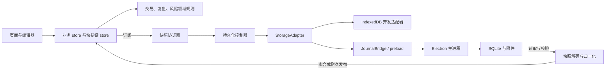

# Trader Atlas 架构地图与治理进度

基线为 `ac1d30c7`。桌面客户端支持 Windows 与 macOS。治理在隔离 worktree 中进行，每批提交包含调用方迁移、对应测试和本页的决策记录。

## 业务与代码所有权

| 工作对象 | 入口、状态所有者和修改位置 | 契约与验证 |
| --- | --- | --- |
| 实盘、模拟、回测、案例 | `src/data/trades.ts` 定义记录。交易真值由 `tradeTruth` 解释，生命周期见 `tradeStatus`、`tradeTransition`；回测按 `backtestProjects` 的项目边界计算 | 财务计算、风险门与回测项目各有行为测试。历史交易日取决于资料库换日设置 |
| 阶段、风险、复盘 | `liveStages`、`riskBudget`、`tradeOpenRiskGate` 形成决策，`riskGatedTradeOpenCommit` 提交并发布；`src/data/weeklyReviews.ts`、`src/lib/reviewSession.ts` 承载周期与随机复盘 | 阶段归属、冻结证据、风险确认和周复盘测试 |
| 页面和输入 | `App.tsx` 组合路由与全局交互，`views` 和 `components` 消费 store、领域规则；编辑器位于 `src/editor`，快捷键作用域与绑定规则位于 `src/shortcuts` | 设计来源依次为 tokens、global CSS、公共组件和局部布局；组件交互用 renderer 测试、Electron 实机验证 |
| 运行状态 | Zustand `useStore` 管理业务集合及部分临时 UI；`shortcutStore` 管理快捷键，`saveStatus` 只描述写入状态。表单本地草稿、路由筛选、持久化视图偏好具有不同生存期 | `persistedKeys` 约束快照字段，`pickPersisted` 投影，`snapshotToRuntimeState` 水合 |
| 保存与并发 | `bootstrap` 安装订阅；`persistedSnapshotCoordinator` 过滤无修改发布；`persistenceController` 排队写入；`cutover` 协调切库交互。正文草稿由 `noteDrafts` 按记录持有 | CAS 修订、批次提交、草稿刷新、恢复与失败补偿分别有测试。store 引用版本和数据库 revision 属于不同时间点 |
| 存储与缓存 | `StorageAdapter` 是接口，`provider` 按环境选实现。桌面通过 preload 调用 SQLite 与附件目录，IndexedDB 用于开发测试。图片临时 URL 的所有者通过 `assetObjectUrls` 取得和释放租约 | `snapshotCodec` 解码历史资料，`snapshotValidation` 校验数据；旧模块兼容见同目录退役记录 |
| 平台接口与信任边界 | `JournalBridge` 定义跨进程 API，`electron/preload.ts` 只暴露命名能力；主窗口启用 sandbox 和 context isolation。主进程处理文件选择、库路径、备份、剪贴板与更新 | 资料库激活、受管路径、退出确认和恢复授权有独立测试。真实库路径优先级见 `libraryLocation` |
| 配置、错误和诊断 | 默认资料配置在 `src/config`；构建开关由 Vite 与打包命令传入；平台启动配置由主进程读取。`OperationalError` 承载业务错误，持久化错误保留具体阶段，主进程与 Web 各有操作日志输出 | 错误展示、诊断脱敏、日志配对、写入重试由各边界的测试负责 |
| 其他交付物 | `tools/atlas-data-editor` 是离线资料库编辑器；`execution-trainer` 有独立进程和模型；`atlas-website`、`atlas-docs-site` 各自构建或验证；`prototypes` 存放独立样稿 | 分别使用离线编辑器测试、训练器 test、官网构建与教学站 verify；产品站点、原型不依赖桌面会话 |
| 验证与发布 | `scripts/test-discovery.mjs` 发现回归入口；`quality-scenarios.json` 关联发布合同；CI 执行 `qa:ci`。候选认证与正式 tag 工作流拥有不同职责 | 安装包清单在 `scripts/release-artifacts.mjs`，最终门禁要求双平台资产 |

## 运行依赖与状态流向

图中箭头覆盖调用和数据流。对基线的 `src`、`electron` 另作静态模块扫描，去除测试、fixture、benchmark、声明和编译时类型后，共得到 383 个 TS/TSX 模块，1,876 条不同的本地同步静态依赖边，未发现强连通环。此统计不含动态加载、IPC 或回调。

## 独立交付物与外部契约

| 交付物 | 状态、外部入口与边界 | 本轮核查 |
| --- | --- | --- |
| 离线资料库编辑器 | 用户通过文件选择器打开来源目录，浏览器内存持有编辑及撤销历史，导出另一个目录。SQLite 元数据中的快照经 Atlas 的 codec 升级。编辑器还需保留未知扩展字段 | 以纯合成 SQLite 库通过编辑、失败导出、重新打开、附件字节及来源库未变校验。单独的 TypeScript 项目现接入 CI |
| Execution Trainer | 主进程限定 IPC 来自本窗口主框架。其 Store 只读写训练器 userData 下的 records，基于训练事件重建按时区划分的训练日及缓存。preload 仅公开训练与窗口操作 | 模型、缓存 10 项回归通过。字体与 Token 使用注明源提交的设计快照。训练记录与 Atlas 交易快照独立演进 |
| 官网与指南 | 官网构建脚本组合静态产品页与指南。指南以 lessons 为章节数据源，搜索索引由内容生成，用户学习进度保存在站点 localStorage。产品截图来自独立演示库 | 章节检测覆盖 11 章、44 步及前置章节引用。网站构建和运行检查在 atlas-website 的 README 有独立入口 |

## 决策与任务池

| 工作项 | 已核实的偏离或差异 | 方案与下一步 |
| --- | --- | --- |
| 持久状态并发判断 | JSON、Notion、交易录入有三份捕获与比较实现；自动保存测试还引用 bootstrap 的非生产比较函数 | 统一两套 store 的取样与判等。保留各入口自己的冲突合并和落盘策略 |
| 风控指纹 | 风险提交、开仓门与导入合并重复对 JSON 排序；两个入口复制 FNV 常量 | 冻结已有历史指纹，再统一规范化及哈希。测试基准独立计算 |
| 附件载荷 | 交易录入、Notion、Web ZIP、Electron 批次均把字节转为 Base64 | 统一字节编码，保留各入口的 MIME、大小限制与回滚 |
| 数据库文件完整性 | 备份、迁移、ZIP 与 IPC 存在重复 fsync 或 SHA-256 读取 | 核对同步读整文件与分块读实现、文件打开方式及异常关闭合同 |
| 架构门禁 | 现有 import 检查使用文本正则，生产模块图尚未纳入 CI | 增加注释、字符串、类型、动态导入与运行时循环的反例 |
| 测试发现 | Node 入口和 DOM 专属例外在 runner 与治理脚本重复定义，证据归属还依赖源码文本 | 从实际测试执行与发现入口核对，保持可追溯的场景 ID |
| 大模块与偏好配置 | `useStore`、`DetailView`、导入导出、IPC 横跨多个变化原因；附件清理有主进程和 renderer 开关 | 沿真实调用链查找可独立迁移的职责，核实开关历史和兼容输入 |
| 独立工具及旧资料 | 训练器与离线编辑器有独立运行合同；历史快照、已退役字段的最小读取路径仍有调用方 | 保留独立交付与历史数据支持；改变平台、签名、文件格式或兼容下限时记录产品决策 |

## 执行记录

- 2026-11-27 建立基线。核对当前入口、历史健康报告和模块退役决策。以上候选来自同函数体扫描、导入图和调用点复查。后续批次以实际验证结果更新本页。
- 持久状态并发判断已迁移。三个提交入口调用 `src/store/persistedRevision.ts`，在等待前冻结同一字段清单的引用，连同快捷键进行比较。协调器的字段判断由生产和测试共用，移除了 bootstrap 上的测试替身。保留各路径对导入碰撞、相同交易并发编辑的不同补偿行为。迁移前联合基线 146 项通过，迁移后本批 75 项通过，两套 TypeScript 配置通过。
- 风控指纹已迁移。开仓判断、耐久提交与风险导入共用 `riskFingerprint`，周期结果的快照副本由 `riskManagement` 创建。先在旧实现采集含中文和代理对字符的开仓指纹、导入 ID，再以固定字面值通过旧版和新版。保留导入载荷自己的 JSON replacer（会调用对象的 toJSON）和性能基准自己的排序与 SHA-256。迁移后风险、store 集成与导入并发 67 项通过。
- 附件字节转换已迁移。8 个模块统一使用 `src/lib/base64.ts` 进行字节编解码；MIME 解析、输入预算及 IndexedDB 的 Blob/FileReader 读取继续由各自边界处理。以 Node Buffer 作独立对照，覆盖空输入、子视图、分块边界和非法编码。98 项附件与导入定向测试及两套类型检查通过。
- 归档 CRC-32 已迁移。Web 写包、Web 分块读取与 Electron 流式解包原有三种实现。现在都以 `crc32(bytes, previous)` 更新同一标准校验值；各自独立检查大小、路径、超时与原子提交。标准向量、每个切分点、空块及两个归档实现的定向测试共 97 项通过。
- 文件完整性检查已迁移。备份、ZIP、IPC、预备归档及 schema 恢复统一调用 `electron/library/fileChecksum.ts`，分块计算 SHA-256。普通文件的读写打开与 fsync 由 `atomicFile` 负责。目录刷新、写入中持有的描述符及 schema 迁移的普通文件校验继续由原调用点负责。迁移前后相同 107 项回归通过，新增空文件、短文件和跨 1 MiB 两次边界的独立对照测试通过。
- 依赖门已接入现有 CI。执行 `pnpm check:governance` 会从 TypeScript 编译输出与项目路径解析配置生成 `test-results/desktop-dependencies.json`，按文件列出同步和延迟依赖。当前 391 个模块有 1,920 条同步边和 42 条延迟边，检查通过。同步循环会报告闭合路径，受保护的纯模块即使通过中间层或延迟加载访问 store、组件或平台实现也会失败。反例与既有治理测试共 7 项通过。该图覆盖本地可静态解析的桌面 JS/TS 模块，IPC、回调和动态计算的路径见运行地图与行为测试。
- macOS 实机验收。修复了全流程脚本中同名“新建随记”按钮及已折叠“随记操作”的定位。用新临时 userData 和两个空白临时库实点 7 组流程，包含带原图录入、平仓、随记转案例、复盘、归档导出恢复及重启后回读，比较原图字节和完整快照，页面错误为零。可操作窗口留在恢复后的随记页。报告位于该 worktree 的 `test-results/module-retirement-full-flow-20261112/desktop.json`。本轮未在 Windows 原生运行。
- 测试发现与证据归属已迁移。DOM 专属附件用例采用现行 browser 命名，删除 runner 和门禁的人工排除项。Node 质量文件共用发现入口，单测门禁支持已被发现的 TSX。执行报告从 Node 原生测试事件取得文件及名称。临时 Git 仓库验证循环注册的两个名称、不可达测试、失败、skip、todo 及旧证据失效；发现器 27 项、新增证据回归与静态治理门通过。
- 操作日志已归一。桌面和 Web 的 13 个调用点继续使用各自入口，开始、首个终态、关联 ID、错误码过滤与失败版本规则归入纯模块 operationLog。主进程负责日志级别和诊断输出，renderer 负责 200 条脱敏记录及读取副本。选择共享事件生命周期，保留两个平台的输出合同。7 项配对、隐私和调用方回归在迁移前后通过，两套类型检查与治理门通过。上一批提交 385fe921 的完整 qa:ci 已通过。
- 历史平仓日维护已迁出业务 store。清理与撤销通过同一个桌面备份与写入边界，清理内核生成的字段差异直接用于构建撤销记录。会话历史的容量与 ID 分配由 tradeHistory 管理。保留 store 操作入口、失败后无关撤销历史、先写盘再发布与丢弃陈旧自动保存的次序。比通用整库切换方案少一次整库水合，也避免重置其他会话状态。10 项原始基线与迁移后 69 项关联回归、两套类型检查及依赖图检查通过。
- 错误恢复审计复现三处交互锁泄漏。历史平仓日维护遇到保存状态异常曾二次恢复并跳过解锁，JSON 导入末次写盘失败、风险开仓提交后保存状态重置失败也会冻结界面。现在由各自的 finally 保证退出，历史清理只归还一次暂停。三组故障注入先在旧版失败，再随 62 项持久化与并发回归通过。后续核对交易录入与 Notion 批次的重复释放逻辑、备份与归档恢复的共用边界。
- 离线编辑器原有独立 tsc 实际报告两个 TS2339。核心编辑操作改用 CanonicalSnapshot 加未知扩展字段的类型，历史阶段字段由 stageMigration 统一识别和移除。主 codec、快照校验及离线导出皆采用该合同，当前 schema 对旧字段仍拒绝。迁移前后离线 SQLite 端到端相同验证通过，新增 v11 扩展字段保留、旧键清除与非法重复扩展 ID 拒绝。79 项迁移及契约测试、三套类型检查、依赖门通过。
- 69f76f44 的完整 qa:ci 及最新 macOS Electron 实测通过。在隔离库的“导入数据健康”页清空并撤销，验证两次备份及恢复后两笔交易的全部字段。构建身份取自主进程与 renderer；报告在 test-results/architecture-date-maintenance/report.json。
- 教学站原先手写第二份 11 章搜索索引，并在输入时重建整个搜索框。搜索摘要与置顶设置已归入章节定义，章节列表、显示编号、搜索顺序和渲染皆取自该清单。去掉启动后插入随记再重编号的步骤。逐项对比旧版所有章节、搜索次序和文案相同；章节验证、静态站构建测试通过。Chromium 在 1440 和 1100 宽度验证 7 个画廊入口、章节练习、中文关键词匹配、空结果和连续输入保留焦点。
- 交易录入与 Notion 导入的批次生命周期已归入 committedPublish。两个调用方各自准备业务数据、合并并发变更，边界统一负责提交、补偿、区分已落盘与未落盘失败、暂停与解锁。复现了预刷新失败时误释放其他操作暂停，以及终态清理异常掩盖已落盘标志。54 项关联测试覆盖几种失败、磁盘与内存不同步、前置暂停、追写重试及补偿失败。131fc07b 的 10K/20K 合成数据持久化正确性基准通过。
- Web 完整归档写入已与会话、存储适配器和 ZIP 解析器解耦。设置页及所有读写互通测试直接调用 webJournalArchiveWriter；大小、数量、版本与 MIME 规则归档于 webJournalArchiveContract。STORE 格式保留，构造 Blob 前核对大小并删除整包拼接缓冲。迁移前后同一含附件样本均为 10,622 字节且 SHA-256 相同，108 项读写与桌面互通回归、类型检查和纯模块门通过。c7c17831 的完整 qa:ci 及 7 组 macOS 全流程通过，另从 Notion 导入合成 ZIP，经 SQLite 回读交易与原图逐字节核对通过。
- 交易录入、Notion 导入、单条及批量 store 更新共用 tradeUpsert。其更新范围仅含交易、策略与品种，开仓准入继续由交互入口执行。复盘重新打开与执行结果重算归入 tradeResult，旧快照与新录入保留各自的缺失交易类型处理，同用字段归一化顺序。单条只查目标，批量对旧记录建立一次索引。新增反例在旧实现复现回测案例被批量写入实盘阶段，现按持久化合同强制归属 null，并验证独立交易不依赖当前阶段。原基线 132 项；迁移后含导入并发和阶段迁移共 154 项，两套类型检查、依赖门、10K/20K 内存插入与更新基准均通过。
