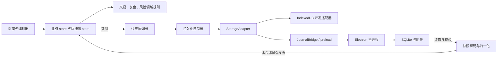

# Trader Atlas 架构地图与治理进度

基线为 `ac1d30c7`。桌面客户端支持 Windows 与 macOS。治理在隔离 worktree 中进行，每批提交包含调用方迁移、对应测试和本页的决策记录。

## 业务与代码所有权

| 工作对象 | 入口、状态所有者和修改位置 | 契约与验证 |
| --- | --- | --- |
| 实盘、模拟、回测、案例 | `src/data/trades.ts` 定义记录。交易真值由 `tradeTruth` 解释，生命周期见 `tradeStatus`、`tradeTransition`；回测按 `backtestProjects` 的项目边界计算 | 财务计算、风险门与回测项目各有行为测试。历史交易日取决于资料库换日设置 |
| 阶段、风险、复盘 | `liveStages`、`riskBudget`、`tradeOpenRiskGate` 形成决策，`riskGatedTradeOpenCommit` 提交并发布；`src/data/weeklyReviews.ts`、`src/lib/reviewSession.ts` 承载周期与随机复盘 | 阶段归属、冻结证据、风险确认和周复盘测试 |
| 页面和输入 | `App.tsx` 组合路由与全局交互，`views` 和 `components` 消费 store、领域规则；编辑器位于 `src/editor`，快捷键作用域与绑定规则位于 `src/shortcuts` | 设计来源依次为 tokens、global CSS、公共组件和局部布局；组件交互用 renderer 测试、Electron 实机验证 |
| 运行状态 | Zustand `useStore` 管理业务集合及部分临时 UI；`shortcutStore` 管理快捷键，`saveStatus` 只描述写入状态。表单本地草稿、路由筛选、持久化视图偏好具有不同生存期 | `persistedKeys` 约束快照字段，`pickPersisted` 投影，`snapshotToRuntimeState` 水合 |
| 保存与并发 | `bootstrap` 安装订阅；`persistedSnapshotCoordinator` 过滤无修改发布；`persistenceController` 排队写入；`cutover` 协调切库交互。正文草稿由 `noteDrafts` 按记录持有 | CAS 修订、批次提交、草稿刷新、恢复与失败补偿分别有测试。store 引用版本和数据库 revision 属于不同时间点 |
| 存储与缓存 | `StorageAdapter` 是接口，`provider` 按环境选实现。桌面通过 preload 调用 SQLite 与附件目录，IndexedDB 用于开发测试。图片临时 URL 的所有者通过 `assetObjectUrls` 取得和释放租约 | `snapshotCodec` 解码历史资料，`snapshotValidation` 校验数据；旧模块兼容见同目录退役记录 |
| 平台接口与信任边界 | `JournalBridge` 定义跨进程 API，`electron/preload.ts` 只暴露命名能力；主窗口启用 sandbox 和 context isolation。主进程处理文件选择、库路径、备份、剪贴板与更新 | 资料库激活、受管路径、退出确认和恢复授权有独立测试。真实库路径优先级见 `libraryLocation` |
| 配置、错误和诊断 | 默认资料配置在 `src/config`；构建开关由 Vite 与打包命令传入；平台启动配置由主进程读取。`OperationalError` 承载业务错误，持久化错误保留具体阶段，主进程与 Web 各有操作日志输出 | 错误展示、诊断脱敏、日志配对、写入重试由各边界的测试负责 |
| 其他交付物 | `tools/atlas-data-editor` 是离线资料库编辑器；`execution-trainer` 有独立进程和模型；`atlas-website`、`atlas-docs-site` 各自构建或验证；`prototypes` 存放独立样稿 | 分别使用离线编辑器测试、训练器 test、官网构建与教学站 verify；产品站点、原型不依赖桌面会话 |
| 验证与发布 | `scripts/test-discovery.mjs` 发现回归入口；`quality-scenarios.json` 关联发布合同；CI 执行 `qa:ci`。候选认证与正式 tag 工作流拥有不同职责 | 安装包清单在 `scripts/release-artifacts.mjs`，最终门禁要求双平台资产 |

## 运行依赖与状态流向

图中箭头覆盖调用和数据流。对基线的 `src`、`electron` 另作静态模块扫描，去除测试、fixture、benchmark、声明和编译时类型后，共得到 383 个 TS/TSX 模块，1,876 条不同的本地同步静态依赖边，未发现强连通环。此统计不含动态加载、IPC 或回调。

## 决策与任务池

| 工作项 | 已核实的偏离或差异 | 方案与下一步 |
| --- | --- | --- |
| 持久状态并发判断 | JSON、Notion、交易录入有三份捕获与比较实现；自动保存测试还引用 bootstrap 的非生产比较函数 | 统一两套 store 的取样与判等。保留各入口自己的冲突合并和落盘策略 |
| 风控指纹 | 风险提交、开仓门与导入合并重复对 JSON 排序；两个入口复制 FNV 常量 | 冻结已有历史指纹，再统一规范化及哈希。测试基准独立计算 |
| 附件载荷 | 交易录入、Notion、Web ZIP、Electron 批次均把字节转为 Base64 | 统一字节编码，保留各入口的 MIME、大小限制与回滚 |
| 数据库文件完整性 | 备份、迁移、ZIP 与 IPC 存在重复 fsync 或 SHA-256 读取 | 核对同步读整文件与分块读实现、文件打开方式及异常关闭合同 |
| 架构门禁 | 现有 import 检查使用文本正则，生产模块图尚未纳入 CI | 增加注释、字符串、类型、动态导入与运行时循环的反例 |
| 测试发现 | Node 入口和 DOM 专属例外在 runner 与治理脚本重复定义，证据归属还依赖源码文本 | 从实际测试执行与发现入口核对，保持可追溯的场景 ID |
| 大模块与偏好配置 | `useStore`、`DetailView`、导入导出、IPC 横跨多个变化原因；附件清理有主进程和 renderer 开关 | 沿真实调用链查找可独立迁移的职责，核实开关历史和兼容输入 |
| 独立工具及旧资料 | 训练器与离线编辑器有独立运行合同；历史快照、已退役字段的最小读取路径仍有调用方 | 保留独立交付与历史数据支持；改变平台、签名、文件格式或兼容下限时记录产品决策 |

## 执行记录

- 2026-11-27 建立基线。核对当前入口、历史健康报告和模块退役决策。以上候选来自同函数体扫描、导入图和调用点复查。后续批次以实际验证结果更新本页。
